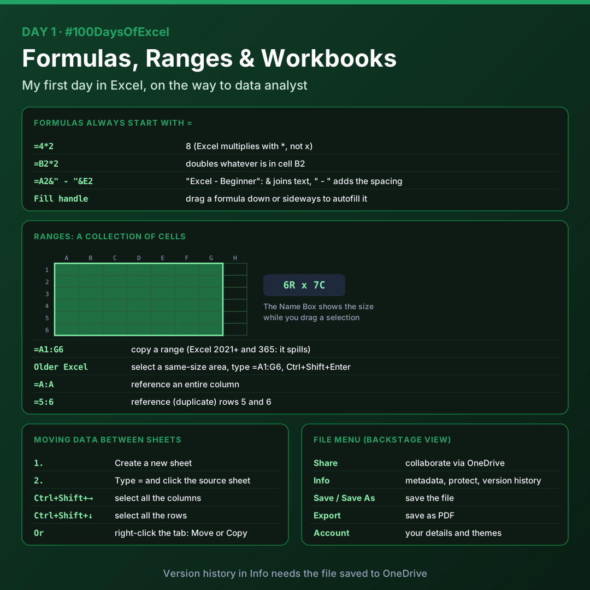

# Day 1: Formulas, Ranges, the Ribbon and Shortcuts

My first day of Excel: how formulas work, selecting and copying ranges, moving data between sheets, the File menu, the Ribbon tabs, and the keyboard shortcuts worth learning first.

Download [`day01_practice.xlsx`](./day01_practice.xlsx) to try everything below.

## Formulas

Formulas always start with an equals sign `=`.

| Formula | Result |
|---------|--------|
| `=4*2` | `8` |
| `=B2*2` | Whatever is in B2, doubled |
| `=A2&" - "&E2` | `Excel - Beginner` (if A2 is "Excel" and E2 is "Beginner") |

- Excel multiplies with `*`, not `x`.
- `&` joins text together. Putting `" - "` in quotes between the cells adds spacing for readability.
- You can **autofill** a formula by dragging the fill handle (the small square at the bottom-right of a cell) down or sideways.

## Ranges

A **range** is a collection of cells, e.g. 10 rows by 20 columns. While you drag to select a range, Excel shows its size in the Name Box on the left, for example `6R x 7C`.

| Formula | What it does |
|---------|--------------|
| `=A1:G6` | Copies the range. In Excel 2021 and Microsoft 365 the result "spills" into neighbouring cells |
| `=A:A` | References an entire column |
| `=5:6` | References entire rows 5 and 6, duplicating them |

**Older versions of Excel:** select an empty area with the same number of rows and columns, type `=A1:G6`, then press **Ctrl+Shift+Enter**.

## Moving data between sheets

1. Create a new sheet in the workbook.
2. Type `=` in the new sheet, then go to the sheet you want to move the data from.
3. Press **Ctrl+Shift+Right Arrow** to select all the columns, then **Ctrl+Shift+Down Arrow** to select all the rows.

Other ways:

- Right-click the sheet tab and choose **Move or Copy**.
- Click the corner at the top-left of the sheet to select everything, then copy and paste.

## File menu (Backstage view)

| Option | What it does |
|--------|--------------|
| Share | Share files with co-workers via OneDrive and collaborate |
| Get Add-ins | Find add-ins |
| Info | Key metadata, protect workbook, version history to revert to previous versions (requires OneDrive) |
| Save / Save As | Save the file |
| Print | Send to a printer |
| Export | Save as PDF |
| Close | Close the workbook |
| Account | Your account details and themes |

## The Ribbon

| Tab | What's in it |
|-----|--------------|
| **Home** | Formatting: fonts, background colour, text size, bold. Number formats (accounting, increase or decrease decimals, dates). Sections: Clipboard, Font, Alignment, Number, Styles, Cells, Add-ins, Editing, Analyze Data |
| **Insert** | Tables (including PivotTable), Illustrations, Controls, Charts, Sparklines, Filters, Links, Comments, Text, Symbols |
| **Draw** | Drawing tools |
| **Page Layout** | Page setup for printing |
| **Formulas** | Browse the available formulas, especially when you don't remember one |
| **Data** | Get & Transform Data, Queries & Connections, Data Types, Sort & Filter, Data Tools, Forecast, Outline |
| **Review** | Reviewing tools |
| **View** | Freeze Panes, e.g. freeze the top row |
| **Help** | Help |

## Shortcuts

| Group | Shortcut | What it does |
|-------|----------|--------------|
| Clipboard | `Ctrl + C` | Copy selected cells |
| Clipboard | `Ctrl + V` | Paste content |
| Clipboard | `Ctrl + X` | Cut selected cells |
| Undo / Redo | `Ctrl + Z` | Undo last action |
| Undo / Redo | `Ctrl + Y` | Redo last action |
| Save / Find | `Ctrl + S` | Save the active workbook |
| Save / Find | `Ctrl + F` | Find data in the worksheet |
| Save / Find | `Ctrl + H` | Find and replace data |
| Formatting | `Ctrl + B` | Apply or remove bold |
| Formatting | `Ctrl + I` | Apply or remove italic |
| Formatting | `Ctrl + U` | Apply or remove underline |
| Formatting | `Ctrl + 1` | Open the Format Cells dialog box |
| Selection | `Ctrl + A` | Select all contents of the worksheet |
| Selection | `Shift + Spacebar` | Select the entire row |
| Selection | `Ctrl + Spacebar` | Select the entire column |
| Navigation | `F2` | Edit the active cell |
| Navigation | `Alt + Enter` | Start a new line within a cell |
| Navigation | `Ctrl + Arrow keys` | Move to the edge of the current data region |
| Navigation | `Ctrl + Shift + Arrow keys` | Select cells to the edge of the current data region |
| Navigation | `Ctrl + Home` | Move to the beginning of the worksheet |
| Navigation | `Ctrl + End` | Move to the last cell with content |
| Navigation | `Ctrl + Page Up / Page Down` | Move between worksheet tabs |
| Navigation | `Ctrl + Shift + U` | Expand or collapse the formula bar |

## Practice workbook

[`day01_practice.xlsx`](./day01_practice.xlsx) has three sheets:

- **Formulas**: multiplication, cell references and joining text with `&`
- **Ranges**: a 5 x 7 data table and a copy of it made with an array formula
- **Shortcuts**: every shortcut above, as a filterable table

## Key takeaways

- Every formula starts with `=`, and Excel multiplies with `*`.
- `&` joins text, so you can build labels from several cells.
- `=A1:G6` copies a whole range in one go.
- Learn the Ctrl+Arrow shortcuts early: they save the most time on big data.

---

[Back to all days](../README.md)
