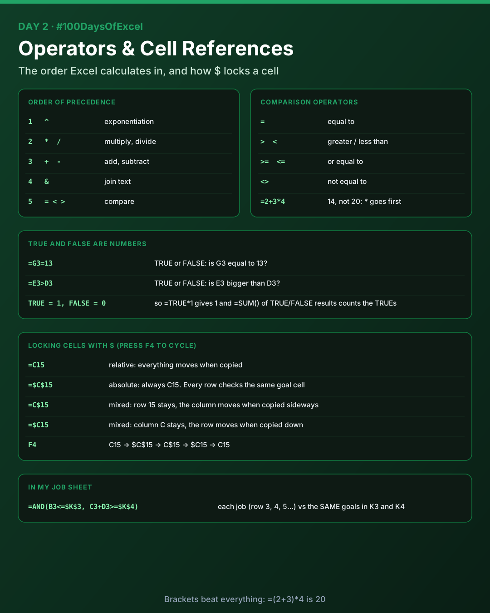
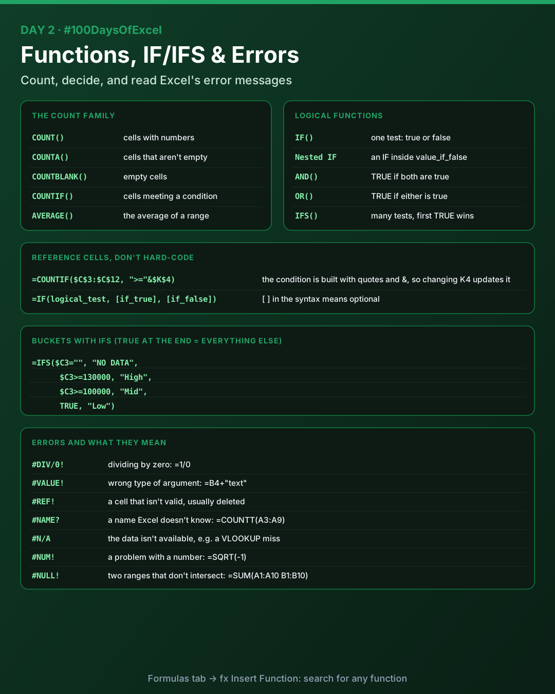

# Day 2: Operators, Cell References, Functions and Errors

Today I learnt the order Excel calculates in, how to lock cells with `$`, the COUNT family, logical functions (IF, nested IF, IFS, AND, OR), buckets, and what each Excel error means.

Download [`day02_practice.xlsx`](./day02_practice.xlsx) to try everything below.



## Order of precedence

Excel doesn't just calculate left to right. It follows this order:

| Order | Operator | What it does |
|-------|----------|--------------|
| 1 | `^` | Exponentiation |
| 2 | `*` `/` | Multiply, divide |
| 3 | `+` `-` | Add, subtract |
| 4 | `&` | Join text |
| 5 | `=` `<` `>` `>=` `<=` `<>` | Compare |

| Formula | Result | Why |
|---------|--------|-----|
| `=2+3*4` | `14` | `*` goes before `+` |
| `=(2+3)*4` | `20` | Brackets go first |
| `=2^3*2` | `16` | `^` goes before `*` |
| `="Data"&" "&"Analyst"` | `Data Analyst` | `&` joins text |

## Comparison operators and boolean checks

| Operator | Meaning |
|----------|---------|
| `=` | Equal to |
| `>` | Greater than |
| `<` | Less than |
| `>=` | Greater than or equal to |
| `<=` | Less than or equal to |
| `<>` | Not equal to |

A comparison returns `TRUE` or `FALSE`:

- `=G3=13` checks whether G3 equals 13
- `=E3>D3` checks whether E3 is bigger than D3

Excel treats `TRUE` as `1` and `FALSE` as `0`, so `=TRUE*1` gives `1` and summing a column of TRUE/FALSE results counts the TRUEs.

## Cell references and F4

| Reference | Type | When you copy the formula |
|-----------|------|---------------------------|
| `=C15` | Relative | Column and row both move |
| `=$C$15` | Absolute | Nothing moves, always C15 |
| `=C$15` | Mixed | Row 15 is locked, the column moves |
| `=$C15` | Mixed | Column C is locked, the row moves |

Click a reference in the formula bar and press **F4** to cycle through them:

`C15` → `$C$15` → `C$15` → `$C15` → `C15`

In my practice sheet every job is checked against the same goals, so the goal cells are absolute:

```
=AND(B3<=$K$3, C3+D3>=$K$4)
```

Copied down, `B3` and `C3` become `B4`, `C4`, `B5`, `C5`... but `$K$3` and `$K$4` never change.

## Functions



You can browse every function from the **Formulas** tab: **fx Insert Function** lets you search, and **Recently Used** shows the ones you've used before.

### The COUNT family

| Function | What it counts |
|----------|----------------|
| `COUNT()` | Cells that contain numbers |
| `COUNTA()` | Cells that aren't empty |
| `COUNTBLANK()` | Empty cells |
| `COUNTIF()` | Cells that meet a condition |
| `AVERAGE()` | Not a count: the average of a range |

### COUNTIF with a cell reference

Instead of typing the number into the condition, put it in a cell and join it with `&`:

```
=COUNTIF($C$3:$C$13, ">="&$K$4)
```

`">="` is in quotes and `&` attaches the value in K4. Change K4 and the count updates by itself.

### IF, nested IF, AND, OR

```
=IF(logical_test, [value_if_true], [value_if_false])
```

Square brackets in a function's syntax mean the argument is optional.

| Function | Returns |
|----------|---------|
| `IF()` | One value if the test is TRUE, another if it's FALSE |
| Nested IF | An `IF` inside another `IF`, for more than two outcomes |
| `AND()` | `TRUE` only if every condition is true |
| `OR()` | `TRUE` if at least one condition is true |

### IFS and buckets

A **bucket** (or bin) is a group you sort values into, like High, Mid and Low salary bands. `IFS` checks conditions in order and returns the value for the first one that's TRUE. A final `TRUE` catches everything else.

```
=IFS($C3="", "NO DATA",
     $C3>=$K$5, "High",
     $C3>=100000, "Mid",
     TRUE, "Low")
```

Order matters: check the blank first, then the biggest band down to the smallest.

## Errors

| Error | Meaning | Example |
|-------|---------|---------|
| `#DIV/0!` | Dividing by zero | `=1/0` |
| `#VALUE!` | Wrong type of argument | `=B4+"text"` |
| `#REF!` | The reference isn't valid, usually a deleted cell | `=#REF!` |
| `#NAME?` | Excel doesn't recognise a name in the formula | `=COUNTT(A3:A9)` |
| `#N/A` | The value isn't available | `=VLOOKUP("missing", A1:B10, 2, FALSE)` |
| `#NUM!` | A problem with a number | `=SQRT(-1)` |
| `#NULL!` | Two ranges that don't intersect (a space instead of a comma) | `=SUM(A1:A3 C1:C3)` |

> `VLOOKUP` needs a range at least as wide as the column number. `=VLOOKUP("value", A1:A10, 2, FALSE)` returns `#REF!`, not `#N/A`, because A1:A10 has only one column.

## Practice workbook

[`day02_practice.xlsx`](./day02_practice.xlsx) has three sheets:

- **Jobs**: 11 jobs checked against goal cells with `AND`, `TRUE*1`, `IFS` salary bands, `OR`, and a COUNT summary block. Change the goals in K3:K5 and watch everything update.
- **Operators**: precedence, `&`, comparisons and TRUE/FALSE as numbers
- **Errors**: one formula that produces each error, with its meaning

## Key takeaways

- Brackets first, then `^`, then `*` `/`, then `+` `-`, then `&`, then comparisons.
- `$` locks what comes right after it. F4 cycles through the options.
- `TRUE` is 1 and `FALSE` is 0.
- Put criteria in cells and reference them, so one change updates everything.
- `IFS` with a final `TRUE` is a clean way to build buckets.

---

[Back to all days](../README.md)
