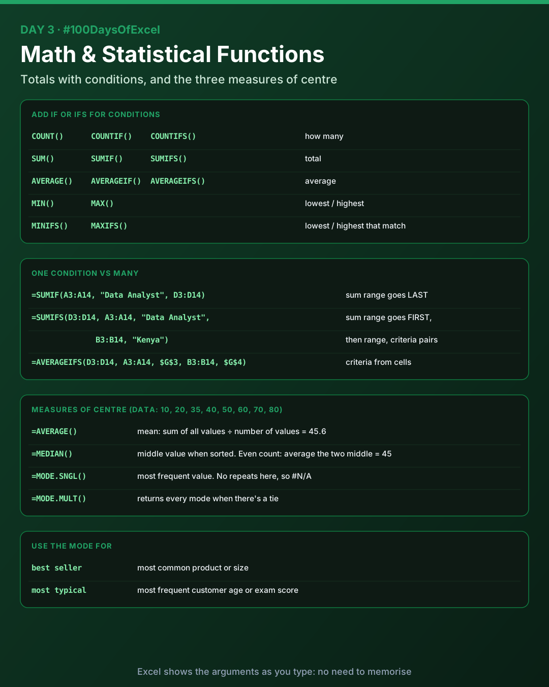
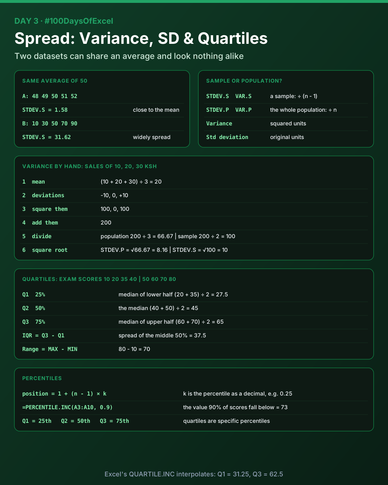

# Day 3: Math and Statistical Functions

Today I learnt the math functions that work with conditions (the IF and IFS families), then moved into the statistical functions used in EDA (Exploratory Data Analysis): mean, median, mode, variance, standard deviation, quartiles, percentiles, IQR and range.

Download [`day03_practice.xlsx`](./day03_practice.xlsx) to try everything below.



## Math functions

You don't need to memorise these. As you type a function, Excel shows its arguments, so read the formula and follow it.

| Basic | One condition | Many conditions |
|-------|---------------|-----------------|
| `COUNT()` / `COUNTA()` | `COUNTIF()` | `COUNTIFS()` |
| `SUM()` | `SUMIF()` | `SUMIFS()` |
| `AVERAGE()` | `AVERAGEIF()` | `AVERAGEIFS()` |
| `MIN()` | | `MINIFS()` |
| `MAX()` | | `MAXIFS()` |

The argument order is different between `SUMIF` and `SUMIFS`:

```
=SUMIF(A3:A14, "Data Analyst", D3:D14)
```

`SUMIF`: range to check, criteria, then the range to add up **last**.

```
=SUMIFS(D3:D14, A3:A14, "Data Analyst", B3:B14, "Kenya")
```

`SUMIFS`, `AVERAGEIFS`, `MINIFS` and `MAXIFS`: the range to calculate on comes **first**, then pairs of range and criteria.

> Excel has no `AVG()` function. Typing it gives `#NAME?`. The function is `AVERAGE()`.

## Measures of centre

### Mean (average)

The mean is the sum of all values divided by the number of values: `=AVERAGE()`.

### Median

The median is the middle value of a sorted dataset. It splits the data into two equal halves.

- Odd number of values: take the middle one
- Even number of values: add the two middle numbers and divide by 2

```
=MEDIAN(A2:A11)
```

### Mode

The mode is the value that appears most often: `=MODE.SNGL(A2:A11)`.

Use it to find the most common product, customer age, exam score or product size.

- `MODE.SNGL()` returns one mode
- `MODE.MULT()` returns every mode when several values tie
- If no value repeats, the result is `#N/A`

## Spread and variation



Two datasets can have the same average but very different distributions:

| Dataset | Values | Average | STDEV.S |
|---------|--------|---------|---------|
| A | 48, 49, 50, 51, 52 | 50 | 1.58 |
| B | 10, 30, 50, 70, 90 | 50 | 31.62 |

This is where standard deviation, variance and range become important.

### Standard deviation

Standard deviation measures how spread out the values are around the mean. In simple terms, it tells you whether your numbers are close together or widely spread apart.

- **Low** standard deviation: values are close to the average (dataset A)
- **High** standard deviation: values are spread far from the average (dataset B)

| Function | Use it when |
|----------|-------------|
| `STDEV.S()` | Your data is a **sample** of a larger population |
| `STDEV.P()` | Your data is the **entire population** you're studying |

### Variance

Variance measures how far values are spread from the mean using **squared** deviations. Think of it as a close relative of standard deviation.

- Variance expresses spread in **squared units**
- Standard deviation expresses spread in the **original units**

| Function | Meaning |
|----------|---------|
| `VAR.P()` | Population variance: divide by n |
| `VAR.S()` | Sample variance: divide by n - 1 (the number of observations minus 1) |

### Calculating variance by hand

| Day | Sales (KSh) | Mean | Deviation | Squared deviation |
|-----|-------------|------|-----------|-------------------|
| Monday | 10 | 20 | -10 | 100 |
| Tuesday | 20 | 20 | 0 | 0 |
| Wednesday | 30 | 20 | +10 | 100 |

1. Mean: (10 + 20 + 30) ÷ 3 = **20**
2. Deviation from the mean: -10, 0, +10
3. Square each deviation: 100, 0, 100
4. Add them: 100 + 0 + 100 = **200**
5. Divide:
   - Population variance = 200 ÷ 3 = **66.67** (`VAR.P`)
   - Sample variance = 200 ÷ (3 - 1) = **100** (`VAR.S`)
6. Standard deviation is the square root of the variance:
   - √66.67 = **8.16** (`STDEV.P`)
   - √100 = **10** (`STDEV.S`)

A square root of a number is a value that gives the original number when multiplied by itself: √9 = 3 because 3 × 3 = 9. Every positive number has two square roots, one positive and one negative (4 × 4 = 16 and -4 × -4 = 16), but `√` and `=SQRT()` return the positive one.

## Quartiles

Quartiles divide a sorted dataset into four equal parts. They help you understand how your data is distributed.

| Quartile | Meaning |
|----------|---------|
| Q1 (first quartile) | 25% of values fall at or below this point |
| Q2 (second quartile) | 50% of values fall at or below this point. Q2 is the median |
| Q3 (third quartile) | 75% of values fall at or below this point |

There's no separate Q4 cut-off. "Q4" refers to the final quarter of the data, above Q3.

### Example: exam scores

`35, 10, 60, 20, 80, 40, 50, 70`

1. Arrange in ascending order: `10, 20, 35, 40, 50, 60, 70, 80`
2. Q2 (the median): (40 + 50) ÷ 2 = **45**
3. Q1, the median of the lower half `10, 20, 35, 40`: (20 + 35) ÷ 2 = **27.5**
4. Q3, the median of the upper half `50, 60, 70, 80`: (60 + 70) ÷ 2 = **65**

> **Excel gives different Q1 and Q3.** The halves method is a valid way to find quartiles by hand, but Excel interpolates between values using the percentile position formula below:
>
> | Method | Q1 | Q2 | Q3 |
> |--------|----|----|----|
> | By hand (median of each half) | 27.5 | 45 | 65 |
> | `=QUARTILE.INC(range, 1/2/3)` | 31.25 | 45 | 62.5 |
> | `=QUARTILE.EXC(range, 1/2/3)` | 23.75 | 45 | 67.5 |
>
> All three are accepted methods. The differences shrink as the dataset gets bigger. Just say which one you used.

## IQR and range

| Measure | Formula | What it tells you | Exam scores |
|---------|---------|-------------------|-------------|
| Interquartile range (IQR) | Q3 - Q1 | How spread out the middle 50% of your data is | 65 - 27.5 = 37.5 |
| Range | Maximum - Minimum | How far apart the smallest and largest values are | 80 - 10 = 70 |

Q1 is the 25th percentile, Q2 the 50th (the median) and Q3 the 75th.

## Percentiles

A percentile tells you the value below which a certain percentage of observations fall.

```
position = 1 + (n - 1) × k
```

- `n` = number of observations
- `k` = the percentile as a decimal (0.25 for the 25th)

| Percentile | Meaning | Exam scores (`PERCENTILE.INC`) |
|------------|---------|--------------------------------|
| 10th | 10% of observations fall below it | 17 |
| 25th | 25% fall below it (Q1) | 31.25 |
| 50th | 50% fall below it (the median) | 45 |
| 75th | 75% fall below it (Q3) | 62.5 |
| 90th | 90% fall below it | 73 |

Quartiles are just specific percentiles: Q1 = 25th, Q2 = 50th, Q3 = 75th.

**Worked example:** the 25th percentile of the 8 exam scores sits at position 1 + (8 - 1) × 0.25 = **2.75**, three quarters of the way from the 2nd value (20) to the 3rd (35): 20 + 0.75 × 15 = **31.25**. That's exactly what `QUARTILE.INC` returns for Q1.

## Practice workbook

[`day03_practice.xlsx`](./day03_practice.xlsx) has four sheets:

- **Math**: 12 data jobs with COUNTIFS, SUMIF, SUMIFS, AVERAGEIF(S), MINIFS and MAXIFS driven by criteria cells. Change the job title, country or remote option in G3:G5 and everything updates.
- **Spread**: datasets A and B side by side with AVERAGE, MEDIAN, range, VAR and STDEV
- **Variance by hand**: the sales example step by step, checked against `VAR.P`, `VAR.S`, `STDEV.P` and `STDEV.S`
- **Quartiles**: exam-score quartiles, IQR, range, percentiles and MODE

## Key takeaways

- Add IF for one condition and IFS for many. In the IFS functions, the range you calculate on comes first.
- Mean, median and mode describe the centre. Range, IQR, variance and standard deviation describe the spread.
- Use `.S` for a sample and `.P` for the whole population.
- Standard deviation is the square root of variance, and it's in the original units.
- Q2 is the median, and quartiles are just the 25th, 50th and 75th percentiles.

---

[Back to all days](../README.md)
