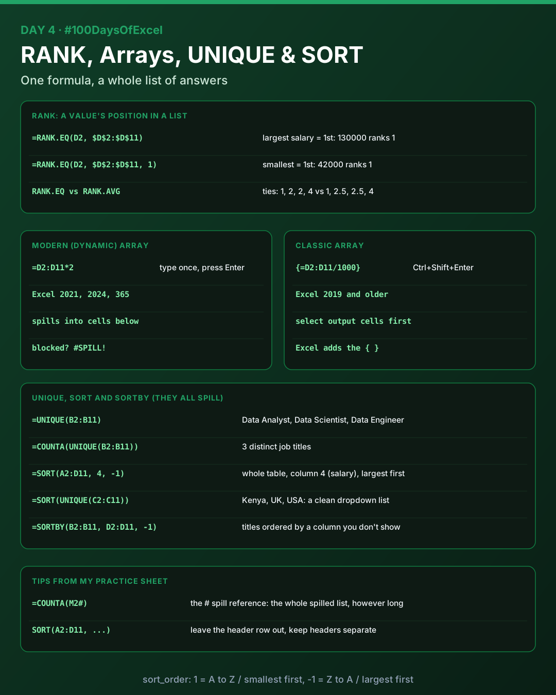
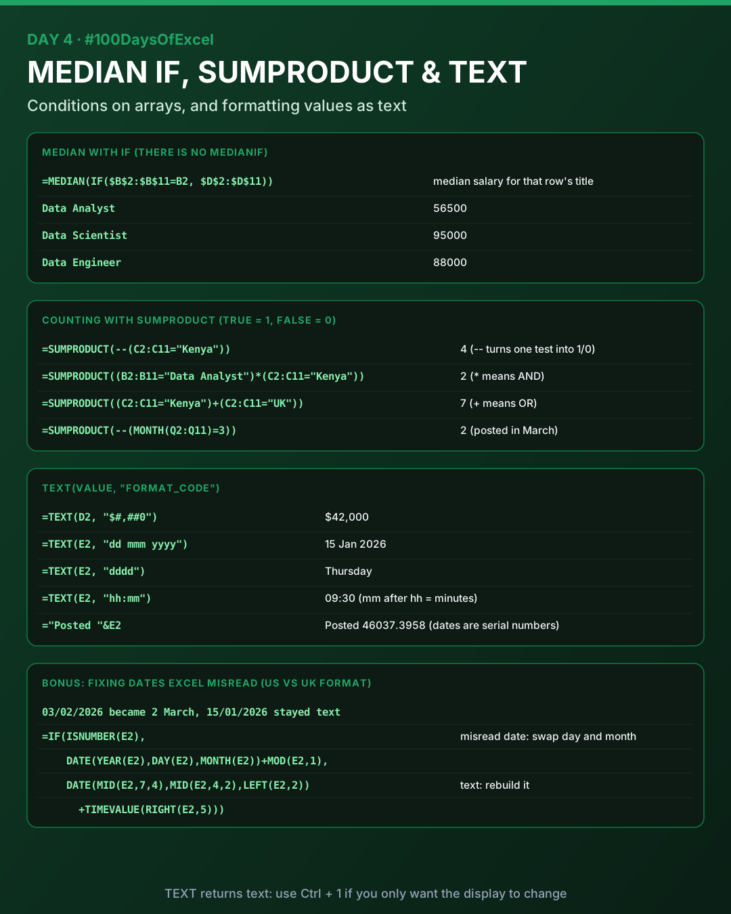

# Day 4: RANK, Array Formulas, SUMPRODUCT and TEXT

Back after a week's break. Today I learnt how to rank values, how array formulas work (modern dynamic arrays and classic Ctrl+Shift+Enter arrays), UNIQUE, SORT and SORTBY, a median with a condition, counting with SUMPRODUCT, and formatting values with TEXT. I practised all of it on a 10-row job postings table.

Download [`day04_practice.xlsx`](./day04_practice.xlsx) to see my practice sheet.



## The practice data

| Job ID | Job Title | Country | Salary ($) | Posted | Skills | Job Code |
|--------|-----------|---------|-----------|--------|--------|----------|
| 101 | Data Analyst | Kenya | 42000 | 15/01/2026 09:30 | SQL, Excel | KE-DA-2026-101 |
| 102 | Data Scientist | USA | 130000 | 03/02/2026 14:45 | Python, SQL | US-DS-2026-102 |
| ... | ... | ... | ... | ... | ... | ... |
| 110 | Data Engineer | Kenya | 55000 | 25/08/2026 12:50 | Python, SQL | KE-DE-2026-110 |

Data is in A2:G11, with headers in row 1.

## RANK

RANK tells you a value's position in a list: 1st, 2nd, 3rd and so on. Use it for top salaries, the best-selling product, or which region came last.

```
=RANK.EQ(number, ref, [order])
```

- `number`: the value you want to rank
- `ref`: the whole list to compare it against (lock it with `$`)
- `order`: 0 or left out = largest is 1st, 1 = smallest is 1st

| Formula | Salary 130000 | Salary 42000 |
|---------|---------------|--------------|
| `=RANK.EQ(D2, $D$2:$D$11)` | 1 | 10 |
| `=RANK.EQ(D2, $D$2:$D$11, 1)` | 10 | 1 |

**Ties:** if two values are equal, `RANK.EQ` gives them the same rank and skips the next number (1, 2, 2, 4). `RANK.AVG` gives them the average instead (1, 2.5, 2.5, 4).

`RANK()` still works, but it's the old version kept for compatibility. Use `RANK.EQ` in new work.

## Array formulas

An array formula works on a whole list of values at once instead of one cell. It can return one answer (a total, a median) or many answers (a whole list).

| | Modern (dynamic) arrays | Classic arrays |
|---|---|---|
| Versions | Excel 2021, 2024, Microsoft 365 | Excel 2019 and older |
| How | Type in one cell, press Enter | Select the output cells first, type, press **Ctrl + Shift + Enter** |
| Looks like | Results **spill** into neighbouring cells, with a border around them | Excel adds `{ }` around the formula |
| My practice | `=D2:D11*2` (salary doubled) | `{=D2:D11/1000}` (salary in thousands) |

- **#SPILL!** means something is blocking the cells the result needs to spill into.
- The **`#` spill reference** points to a whole spilled result: if UNIQUE spills from M2, `=COUNTA(M2#)` counts it however long it gets.

## UNIQUE and SORT

Both are dynamic array functions: type in one cell, press Enter, and the results spill.

| Formula | What it does | Result |
|---------|--------------|--------|
| `=UNIQUE(B2:B11)` | Removes duplicates | Data Analyst, Data Scientist, Data Engineer |
| `=COUNTA(UNIQUE(B2:B11))` | Counts distinct values | 3 |
| `=SORT(A2:D11, 4, -1)` | Sorts the table by its 4th column (salary), largest first | Job 102 (130000) at the top |
| `=SORT(UNIQUE(C2:C11))` | A clean alphabetical list, e.g. for a dropdown | Kenya, UK, USA |
| `=SORTBY(B2:B11, D2:D11, -1)` | Sorts one range by another, even one you don't show | Titles from best to worst paid |

Syntax:

```
=UNIQUE(array, [by_col], [exactly_once])
=SORT(array, [sort_index], [sort_order], [by_col])
=SORTBY(array, by_array, [sort_order])
```

- `sort_index`: which column of the range to sort by (1 = first column of the range)
- `sort_order`: 1 = A to Z / smallest first (default), -1 = Z to A / largest first

> **Leave the header row out of SORT.** In my practice sheet I sorted `A1:D11`, which includes the headers. It worked only because text sorts above numbers in a descending sort. `SORT(A2:D11, 4, -1)` with the headers typed above is the safe version.

## MEDIAN with IF



Excel has `AVERAGEIF` but no `MEDIANIF`. To get the median of only the rows that meet a condition, put `IF` inside `MEDIAN`:

```
=MEDIAN(IF($B$2:$B$11=B2, $D$2:$D$11))
```

`IF` keeps the salaries where the title matches and returns FALSE everywhere else. `MEDIAN` ignores the FALSEs. Copied down, each row shows the median for its own job title or country:

| Job title | Median salary | Country | Median salary |
|-----------|---------------|---------|---------------|
| Data Analyst | 56500 | Kenya | 51500 |
| Data Scientist | 95000 | USA | 125000 |
| Data Engineer | 88000 | UK | 88000 |

## Counting with SUMPRODUCT

`SUMPRODUCT` multiplies lists item by item, then adds up the results. It handles arrays natively, so it never needs Ctrl + Shift + Enter, even in old Excel. Because TRUE = 1 and FALSE = 0, it can count rows that pass tests.

| Question | Formula | Result |
|----------|---------|--------|
| Kenyan jobs | `=SUMPRODUCT(--(C2:C11="Kenya"))` | 4 |
| Data Analysts in Kenya | `=SUMPRODUCT((B2:B11="Data Analyst")*(C2:C11="Kenya"))` | 2 |
| Jobs in Kenya OR the UK | `=SUMPRODUCT((C2:C11="Kenya")+(C2:C11="UK"))` | 7 |
| Jobs posted in March | `=SUMPRODUCT(--(MONTH(Q2:Q11)=3))` | 2 |
| Total Kenyan salaries | `=SUMPRODUCT((C2:C11="Kenya")*D2:D11)` | 205000 |

- `*` between tests = **AND** (both must be TRUE: 1 × 1 = 1)
- `+` between tests = **OR** (either can be TRUE)
- `--` (double minus) turns a single TRUE/FALSE list into 1/0. You need it when there's only one test, because nothing else forces the conversion.

## TEXT

`TEXT` turns a number or date into text that looks exactly how you want.

```
=TEXT(value, "format_code")
```

The format code always goes in double quotes.

| Code | Meaning | Example |
|------|---------|---------|
| `0` | Always show a digit | `=TEXT(D2, "0.00")` → 42000.00 |
| `#` | Show a digit only if needed | |
| `,` | Thousands separator | `=TEXT(D2, "$#,##0")` → $42,000 |
| `d` / `dd` / `ddd` / `dddd` | Day | 5 / 05 / Thu / Thursday |
| `m` / `mm` / `mmm` / `mmmm` | Month | 1 / 01 / Jan / January |
| `yy` / `yyyy` | Year | 26 / 2026 |
| `hh` / `ss` | Hours / seconds | |

`mm` straight after `hh` means **minutes**. On its own it means **month**.

**When you need it:** when you join a date or number to text with `&`. Excel shows dates formatted, but stores them as serial numbers:

- `="Posted "&E2` gives `Posted 46037.3958333333`
- `="Posted "&TEXT(E2, "dd mmm yyyy")` gives `Posted 15 Jan 2026`

The result is text, so you can no longer do maths on it or sort it as a date. If you only want a cell to look different, use **Ctrl + 1** (Format Cells) instead. That changes the display and keeps the real value.

## Bonus: fixing dates Excel misread

When I typed the dates in day/month/year order, my Excel (set to month/day/year) did two different wrong things:

- `03/02/2026` (3 February) was read as **2 March**
- `15/01/2026` stayed as **text**, because there is no month 15

Column Q fixes both cases in one formula:

```
=IF(ISNUMBER(E2),
    DATE(YEAR(E2), DAY(E2), MONTH(E2)) + MOD(E2, 1),
    DATE(MID(E2, 7, 4), MID(E2, 4, 2), LEFT(E2, 2)) + TIMEVALUE(RIGHT(E2, 5)))
```

- If Excel made it a date, swap the day and month back. `MOD(E2, 1)` keeps the time (the decimal part).
- If it's text, rebuild the date from its pieces with `MID` and `LEFT`, and the time with `TIMEVALUE`.

The "jobs posted in March" count uses the fixed column Q, not E.

## Files

| File | What's in it |
|------|--------------|
| [`day04_practice.xlsx`](./day04_practice.xlsx) | My practice sheet: RANK both ways, a dynamic and a classic array, MEDIAN with IF by title and by country, UNIQUE with a count, SORT, SORTBY, four SUMPRODUCT counts and the date fix |

## Key takeaways

- `RANK.EQ` ranks largest first by default. Add `1` to rank smallest first.
- Modern Excel spills with a plain Enter. Classic arrays need Ctrl + Shift + Enter.
- `UNIQUE`, `SORT` and `SORTBY` replace a lot of manual copying and sorting.
- No `MEDIANIF`? Use `MEDIAN(IF(...))`.
- In `SUMPRODUCT`, `*` is AND, `+` is OR, and `--` turns TRUE/FALSE into 1/0.
- `TEXT` is for display only. Real data cleaning keeps values as numbers and dates.

---

[Back to all days](../README.md)
