# Day 5: Lookups, Text Functions, and Dates and Times

Today covered three groups of functions that a data analyst uses every day:

- **Lookups**, to pull related information from another table
- **Text functions**, to break messy codes and lists into clean pieces
- **Date and time functions**, to work with when things happened

Download [`day05_practice.xlsx`](./day05_practice.xlsx). It has a Data sheet plus one sheet each for lookups, text and dates. Every formula is shown next to its live result.

## The practice data

| Job ID | Job Title | Country | Salary ($) | Posted | Skills | Job Code |
|--------|-----------|---------|-----------|--------|--------|----------|
| 101 | Data Analyst | Kenya | 42000 | 15/01/2026 09:30 | SQL, Excel | KE-DA-2026-101 |
| 105 | Data Analyst | Kenya | 48000 | 28/03/2026 11:05 | SQL, Tableau | KE-DA-2026-105 |
| ... | ... | ... | ... | ... | ... | ... |

Ten rows in A2:G11. The examples below use row 2 (job 101) and job 105.

---

## Lookup functions

A lookup finds a value in one place and brings back related information, like looking up a name in a phone book to get the number. It's the Excel version of a SQL JOIN.

### VLOOKUP: vertical lookup

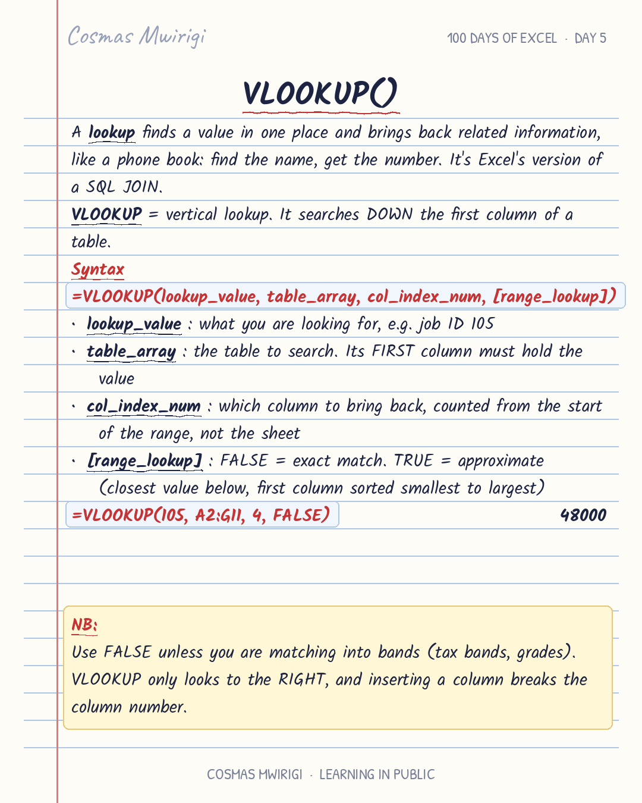

```
=VLOOKUP(lookup_value, table_array, col_index_num, [range_lookup])
```

| Argument | Meaning |
|----------|---------|
| `lookup_value` | What you're looking for, e.g. job ID 105 |
| `table_array` | The table to search. Its first column must hold the value |
| `col_index_num` | Which column to return, counted from the start of the range, not the whole sheet |
| `range_lookup` | `FALSE` = exact match. `TRUE` = approximate match (the closest value below). For TRUE the first column must be sorted smallest to largest |

`=VLOOKUP(105, A2:G11, 4, FALSE)` returns **48000**.

- Always use `FALSE` unless you're matching into bands, like tax bands or grade boundaries.
- **Limits:** it can only search the first column and look to the right. Inserting a column into the table breaks the column number.

### HLOOKUP: horizontal lookup

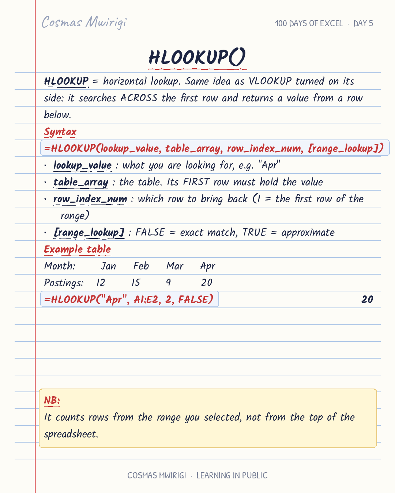

Same idea as VLOOKUP, turned on its side. It searches the first **row** and returns from a row below.

```
=HLOOKUP(lookup_value, table_array, row_index_num, [range_lookup])
```

| Month | Jan | Feb | Mar | Apr |
|-------|-----|-----|-----|-----|
| Postings | 12 | 15 | 9 | 20 |

`=HLOOKUP("Apr", A1:E2, 2, FALSE)` returns **20**. It counts rows from the range you selected, not from the top of the spreadsheet.

### XLOOKUP: the modern replacement for both

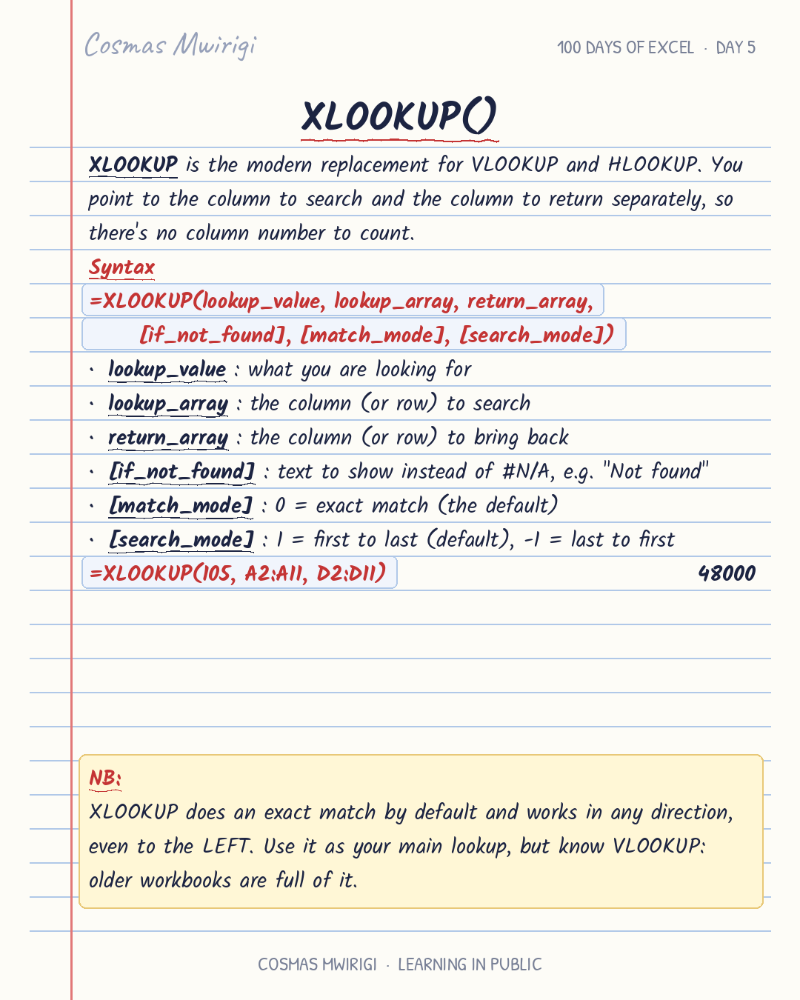

```
=XLOOKUP(lookup_value, lookup_array, return_array, [if_not_found], [match_mode], [search_mode])
```

You point to the column to search and the column to return separately, so there's no column number to count.

| Formula | Result |
|---------|--------|
| `=XLOOKUP(105, A2:A11, D2:D11)` | 48000 |
| `=XLOOKUP("UK-DE-2026-104", G2:G11, A2:A11)` | 104 (it looks left) |
| `=XLOOKUP(999, A2:A11, D2:D11, "Not found")` | Not found |
| `=XLOOKUP("Data Analyst", B2:B11, A2:A11, , 0, -1)` | 108 (the last match, searching from the bottom) |

XLOOKUP does an exact match by default and works in any direction. Use it as your main lookup, but know VLOOKUP, because older workbooks are full of it.

### MATCH and INDEX

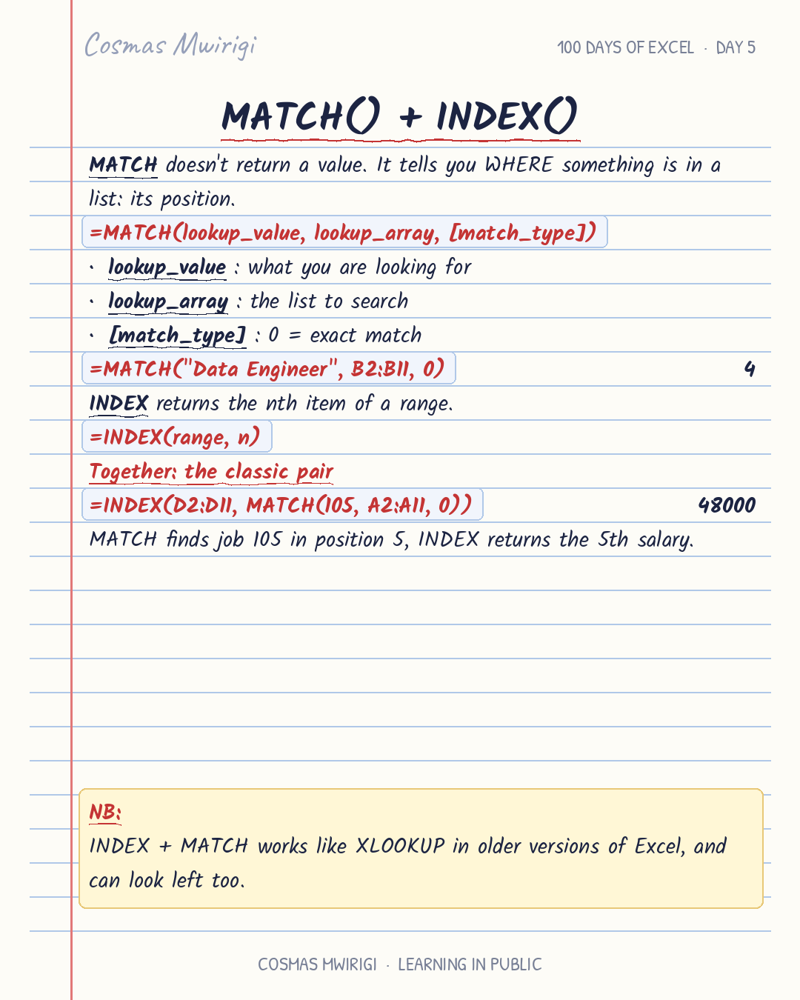

`MATCH` doesn't return a value. It tells you **where** something is in a list.

```
=MATCH(lookup_value, lookup_array, [match_type])
```

Use `0` for an exact match. `=MATCH("Data Engineer", B2:B11, 0)` returns **4**.

`INDEX(range, n)` returns the nth item of a range. Together they're the classic pair, and they work like XLOOKUP in older Excel:

```
=INDEX(D2:D11, MATCH(105, A2:A11, 0))
```

MATCH finds job 105 in position 5, so INDEX returns the 5th salary: **48000**.

### TRANSPOSE

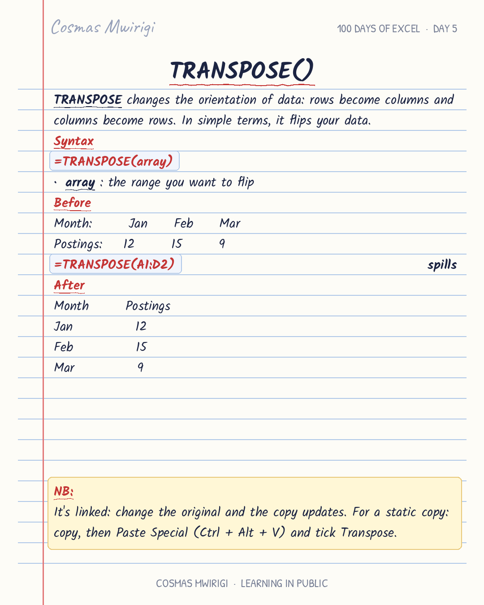

Transposing changes the orientation of data: rows become columns and columns become rows. In simple terms, it flips your data.

| Month | Jan | Feb | Mar |
|-------|-----|-----|-----|
| Postings | 12 | 15 | 9 |

`=TRANSPOSE(A1:D2)` spills:

| Month | Postings |
|-------|----------|
| Jan | 12 |
| Feb | 15 |
| Mar | 9 |

It's linked: change the original and the copy updates. For a static copy, use Paste Special (**Ctrl + Alt + V**) and tick **Transpose**.

---

## Text functions

Real data arrives messy: codes, names and skills crammed into one cell. Text functions pull out exactly the piece you need.

Example cell: **G2 = `KE-DA-2026-101`**, which is 14 characters long.

### LEFT, RIGHT, MID and LEN: take characters by position

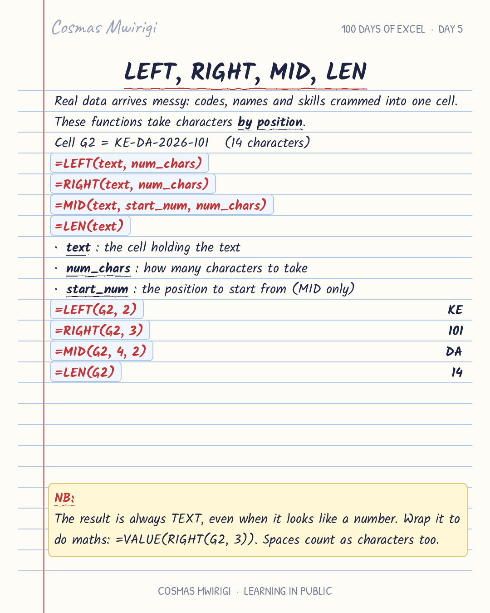

| Function | Syntax | Example | Result |
|----------|--------|---------|--------|
| LEFT | `LEFT(text, num_chars)` | `=LEFT(G2, 2)` | KE |
| RIGHT | `RIGHT(text, num_chars)` | `=RIGHT(G2, 3)` | 101 |
| MID | `MID(text, start_num, num_chars)` | `=MID(G2, 4, 2)` | DA |
| LEN | `LEN(text)` | `=LEN(G2)` | 14 |

The result is always **text**, even when it looks like a number. To do maths with it, wrap it in `VALUE()`: `=VALUE(RIGHT(G2, 3))`. `VALUE` converts text that represents a number into an actual number.

### FIND and SEARCH: get the position of something

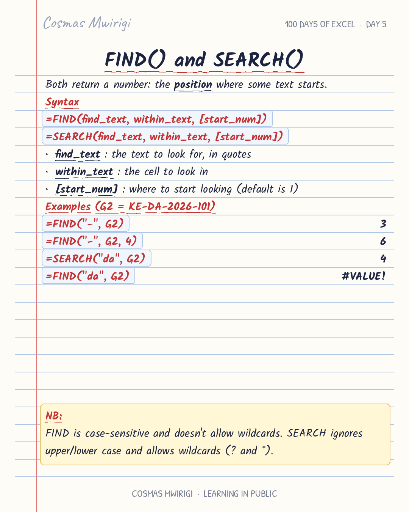

Both return a number: the position where the text starts.

| Formula | Result | Why |
|---------|--------|-----|
| `=FIND("-", G2)` | 3 | The first hyphen is the 3rd character |
| `=FIND("-", G2, 4)` | 6 | Start looking at position 4, so it finds the second hyphen |
| `=SEARCH("da", G2)` | 4 | SEARCH ignores upper and lower case |
| `=FIND("da", G2)` | #VALUE! | FIND is case-sensitive, and G2 has "DA", not "da" |

- **FIND** is case-sensitive and doesn't allow wildcards.
- **SEARCH** ignores case and allows wildcards (`?` = one character, `*` = any number of characters).
- Spaces take positions too: two spaces are two positions.

### Text extraction: combine them

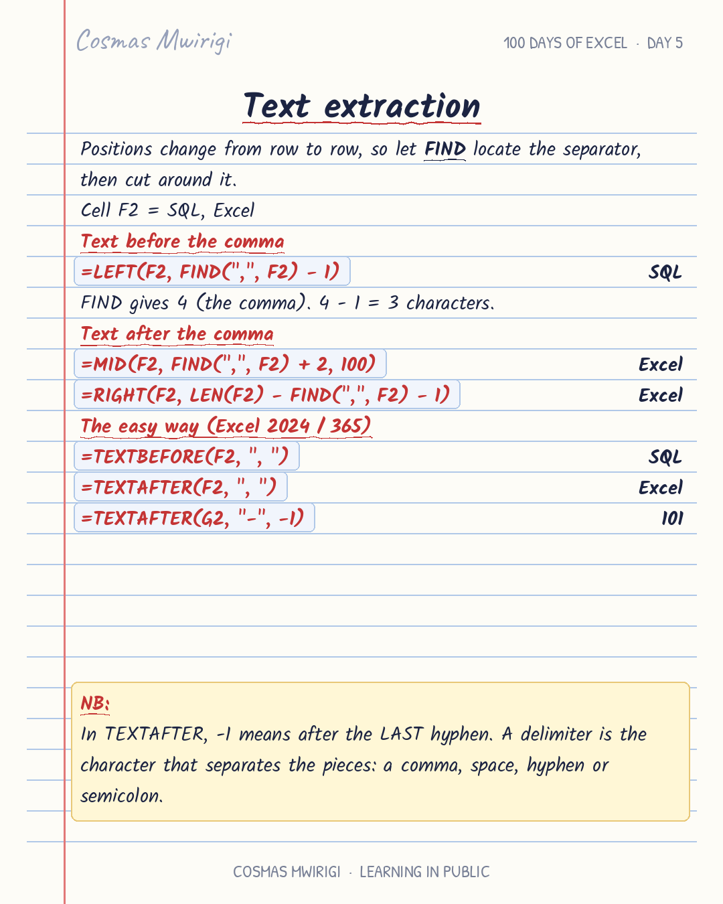

Example cell: **F2 = `SQL, Excel`**

| Goal | Formula | Result |
|------|---------|--------|
| Text before the comma | `=LEFT(F2, FIND(",", F2) - 1)` | SQL |
| Text after the comma | `=MID(F2, FIND(",", F2) + 2, 100)` | Excel |
| Same, with RIGHT | `=RIGHT(F2, LEN(F2) - FIND(",", F2) - 1)` | Excel |

How the first one works: FIND gives 4 (the comma's position). We want everything before it, so 4 - 1 = 3 characters, and LEFT(F2, 3) = SQL.

**Excel 2024 and Microsoft 365** have shortcuts:

| Formula | Result |
|---------|--------|
| `=TEXTBEFORE(F2, ", ")` | SQL |
| `=TEXTAFTER(F2, ", ")` | Excel |
| `=TEXTAFTER(G2, "-", -1)` | 101 (-1 = after the last hyphen) |

### TEXTJOIN and TEXTSPLIT

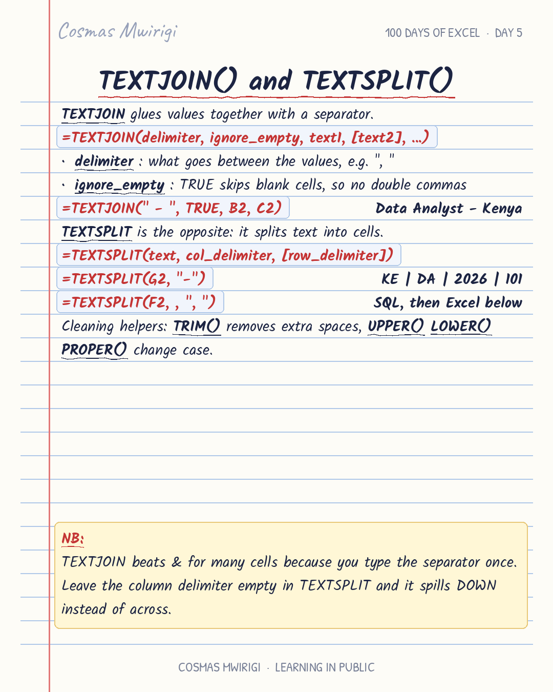

**TEXTJOIN** glues values together with a separator:

```
=TEXTJOIN(delimiter, ignore_empty, text1, [text2], ...)
```

- `=TEXTJOIN(" - ", TRUE, B2, C2)` returns `Data Analyst - Kenya`
- `=TEXTJOIN(", ", TRUE, UNIQUE(C2:C11))` returns `Kenya, USA, UK`
- `ignore_empty` = TRUE skips blank cells, so you don't get double commas. It's better than `&` for many cells because you type the separator once.

**TEXTSPLIT** is the opposite of TEXTJOIN:

```
=TEXTSPLIT(text, col_delimiter, [row_delimiter])
```

- `=TEXTSPLIT(G2, "-")` spills across 4 cells: KE | DA | 2026 | 101
- `=TEXTSPLIT(F2, , ", ")` leaves the column delimiter empty, so it spills **down**: SQL, then Excel

A **delimiter** is a character or symbol that separates pieces of text, such as a comma, space, hyphen or semicolon.

**Cleaning helpers worth knowing:** `TRIM()` removes extra spaces. `UPPER()`, `LOWER()` and `PROPER()` change the case.

---

## Date and time functions

### How Excel stores dates

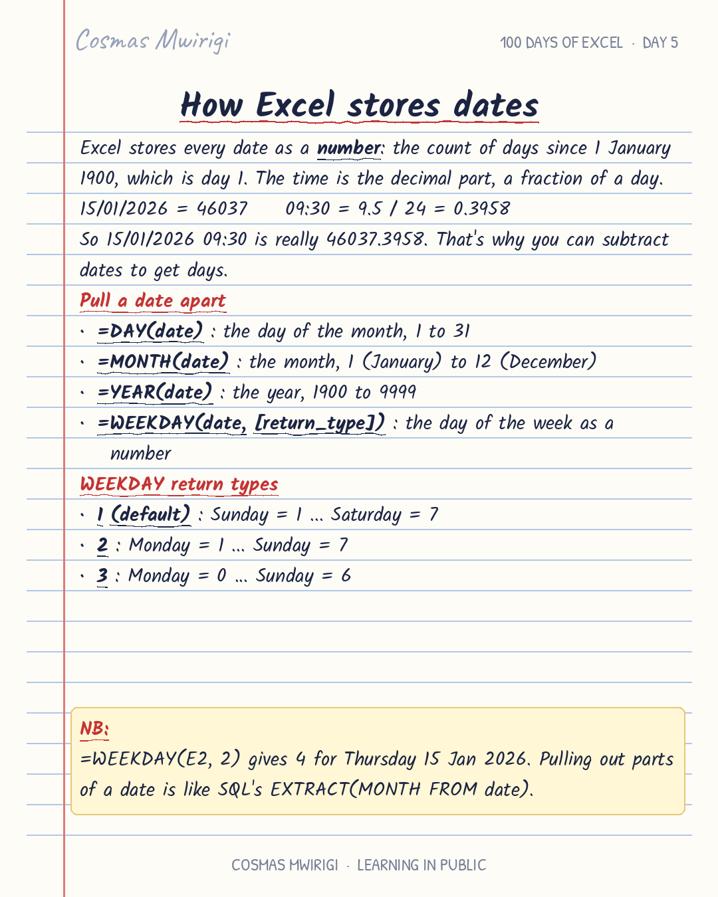

Excel stores every date as a number: the count of days since 1 January 1900, which is day 1. The time is the decimal part, a fraction of a day.

- 15/01/2026 = **46037**
- 09:30 = 9.5 ÷ 24 = **0.3958**
- So 15/01/2026 09:30 is really **46037.3958**

This is why you can subtract one date from another to get days, and add 7 to a date to move a week ahead.

### DAY, MONTH, YEAR and WEEKDAY

| Function | Returns |
|----------|---------|
| `=DAY(date)` | The day of the month, from 1 to 31 |
| `=MONTH(date)` | The month, from 1 (January) to 12 (December) |
| `=YEAR(date)` | The year, from 1900 to 9999 |
| `=WEEKDAY(serial_number, [return_type])` | A number from 1 to 7 for the day of the week |

`serial_number` is the date you want to examine. `return_type` decides how Excel numbers the days:

| Return type | Numbering |
|-------------|-----------|
| 1 (default) | Sunday = 1, Monday = 2 ... Saturday = 7 |
| 2 | Monday = 1, Tuesday = 2 ... Sunday = 7 |
| 3 | Monday = 0, Tuesday = 1 ... Sunday = 6 |

`=WEEKDAY(E2, 2)` returns **4** for Thursday 15 January 2026, because Monday is day 1. Pulling parts out of a date is like SQL's `EXTRACT(MONTH FROM date)`.

### DATE, TODAY, NOW and DATEDIF

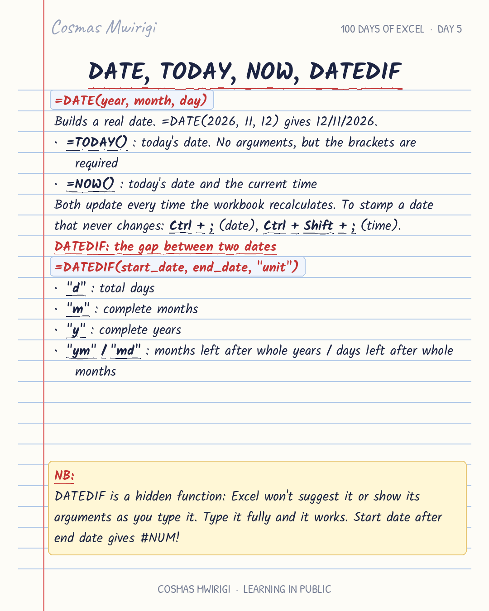

```
=DATE(year, month, day)
```

`=DATE(2026, 11, 12)` creates the real date 12/11/2026.

- `=TODAY()` returns today's date. It takes no arguments, but the brackets are required.
- `=NOW()` returns today's date and the current time.
- Both update every time the workbook recalculates, so tomorrow they show tomorrow.
- To stamp a date that never changes: **Ctrl + ;** for today's date, **Ctrl + Shift + ;** for the time.

**DATEDIF** calculates the gap between two dates:

```
=DATEDIF(start_date, end_date, "unit")
```

| Unit | Meaning |
|------|---------|
| `"d"` | Total days |
| `"m"` | Complete months |
| `"y"` | Complete years |
| `"ym"` | Months left after whole years |
| `"md"` | Days left after whole months |

`=DATEDIF(E2, TODAY(), "m")` gives the number of complete months since job 101 was posted. DATEDIF is a hidden function: Excel won't suggest it or show its arguments as you type. Type it in full and it works.

### HOUR, MINUTE, SECOND and TEXT for dates

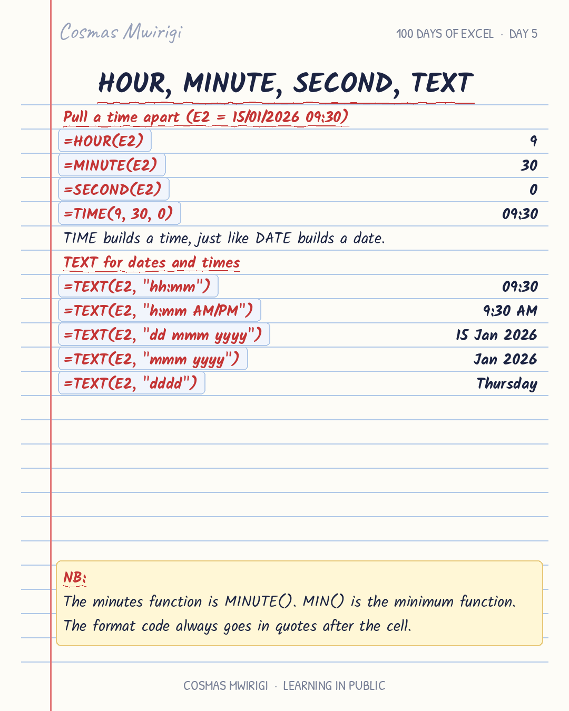

| Formula | Result |
|---------|--------|
| `=HOUR(E2)` | 9 |
| `=MINUTE(E2)` | 30 |
| `=SECOND(E2)` | 0 |
| `=TIME(9, 30, 0)` | 09:30 (builds a time, like DATE builds a date) |

The minutes function is `MINUTE()`. `MIN()` is the minimum function.

For TEXT, the format code goes in quotes after the cell:

| Formula | Result |
|---------|--------|
| `=TEXT(E2, "hh:mm")` | 09:30 |
| `=TEXT(E2, "h:mm AM/PM")` | 9:30 AM |
| `=TEXT(E2, "dd mmm yyyy")` | 15 Jan 2026 |
| `=TEXT(E2, "mmm yyyy")` | Jan 2026 |
| `=TEXT(E2, "dddd")` | Thursday |

---

## Cheat sheet

| Function | One-line job |
|----------|--------------|
| `VLOOKUP(value, table, col, FALSE)` | Look down the first column, return to the right |
| `HLOOKUP(value, table, row, FALSE)` | Look across the first row, return below |
| `XLOOKUP(value, look_in, return)` | Modern lookup, any direction |
| `MATCH(value, range, 0)` | Position of a value in a list |
| `INDEX(range, n)` | The nth item of a range |
| `TRANSPOSE(range)` | Swap rows and columns |
| `LEFT` / `RIGHT` / `MID` | Characters from the start / end / middle |
| `LEN(text)` | Number of characters |
| `FIND` / `SEARCH` | Position of text. FIND is case-sensitive, SEARCH is not |
| `TEXTBEFORE` / `TEXTAFTER` | Text before / after a separator |
| `TEXTJOIN(sep, TRUE, range)` | Join many cells with a separator |
| `TEXTSPLIT(text, sep)` | Split text into cells |
| `DAY` / `MONTH` / `YEAR` | Parts of a date |
| `WEEKDAY(date, [type])` | The day of the week as a number |
| `DATE(y, m, d)` | Build a date |
| `TODAY()` / `NOW()` | Today's date / date and time, always current |
| `DATEDIF(start, end, "unit")` | Days, months or years between two dates |
| `HOUR` / `MINUTE` / `SECOND` | Parts of a time |

## Practice workbook

[`day05_practice.xlsx`](./day05_practice.xlsx) has four sheets:

- **Data**: the 10 job postings, with real dates
- **Lookups**: VLOOKUP (exact and approximate salary bands), HLOOKUP, four XLOOKUPs, MATCH and INDEX + MATCH
- **Text**: LEFT, RIGHT, MID, LEN, VALUE, FIND, SEARCH, extraction combos, TEXTBEFORE, TEXTAFTER, TEXTJOIN, TRIM, PROPER and UPPER
- **Dates**: the stored serial number, DAY, MONTH, YEAR, all three WEEKDAY return types, DATE, TODAY, NOW, DATEDIF, HOUR, MINUTE, SECOND, TIME and five TEXT formats

TRANSPOSE and TEXTSPLIT spill into several cells, so the sheets tell you where to type them yourself.

## Key takeaways

- Use XLOOKUP for lookups, and know VLOOKUP and INDEX + MATCH for older workbooks.
- Text functions always return text. Wrap the result in `VALUE()` before doing maths with it.
- Let FIND locate the separator, so one formula works on every row.
- Dates are numbers, which is why you can subtract them, and why `TEXT` is needed to display them.

---

[Back to all days](../README.md)
