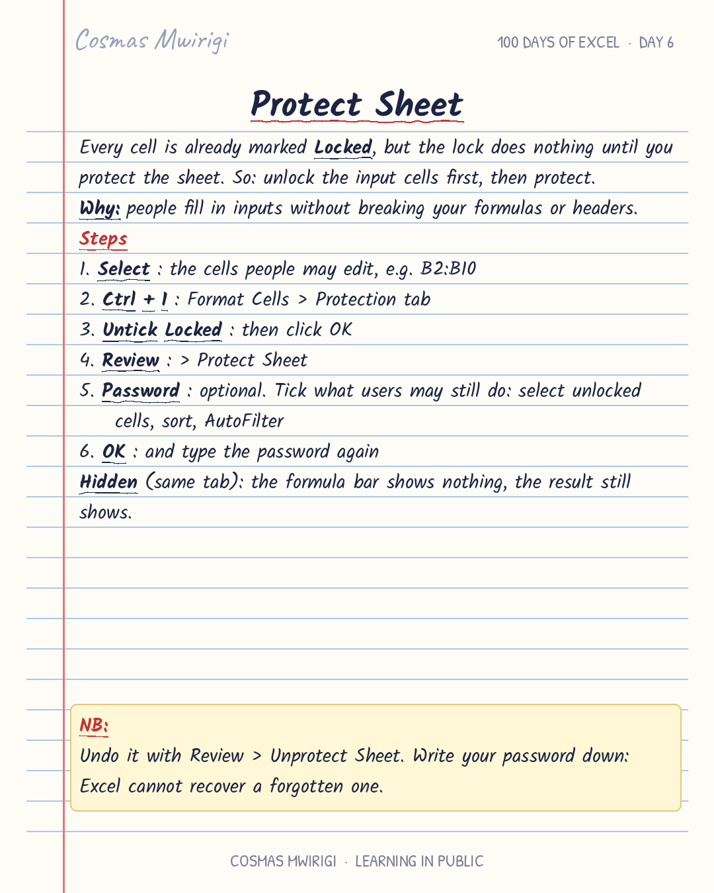
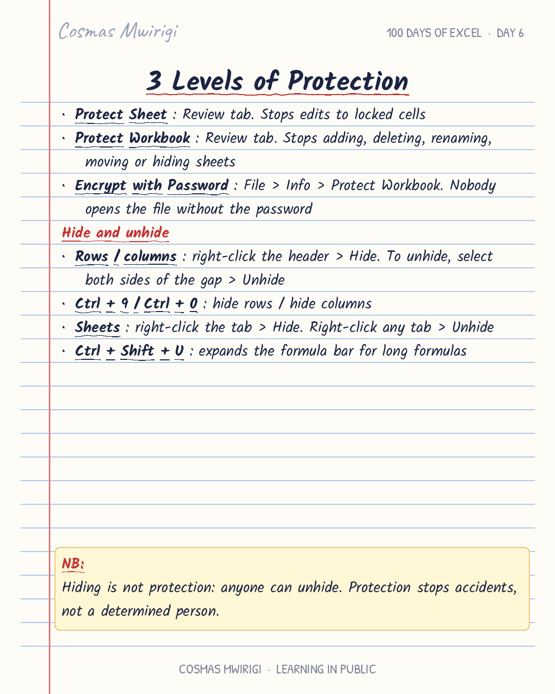
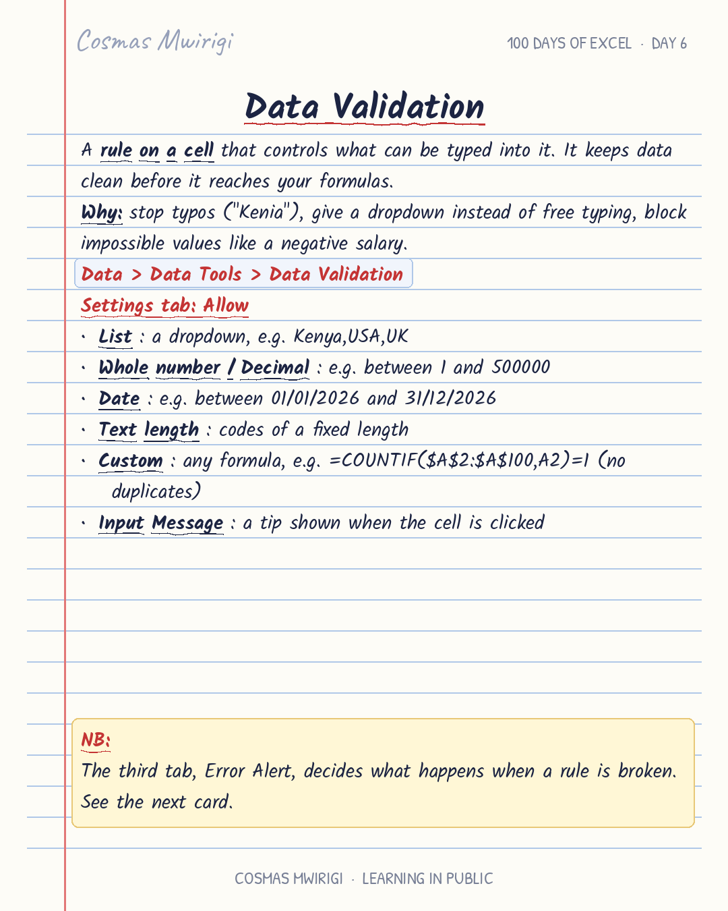
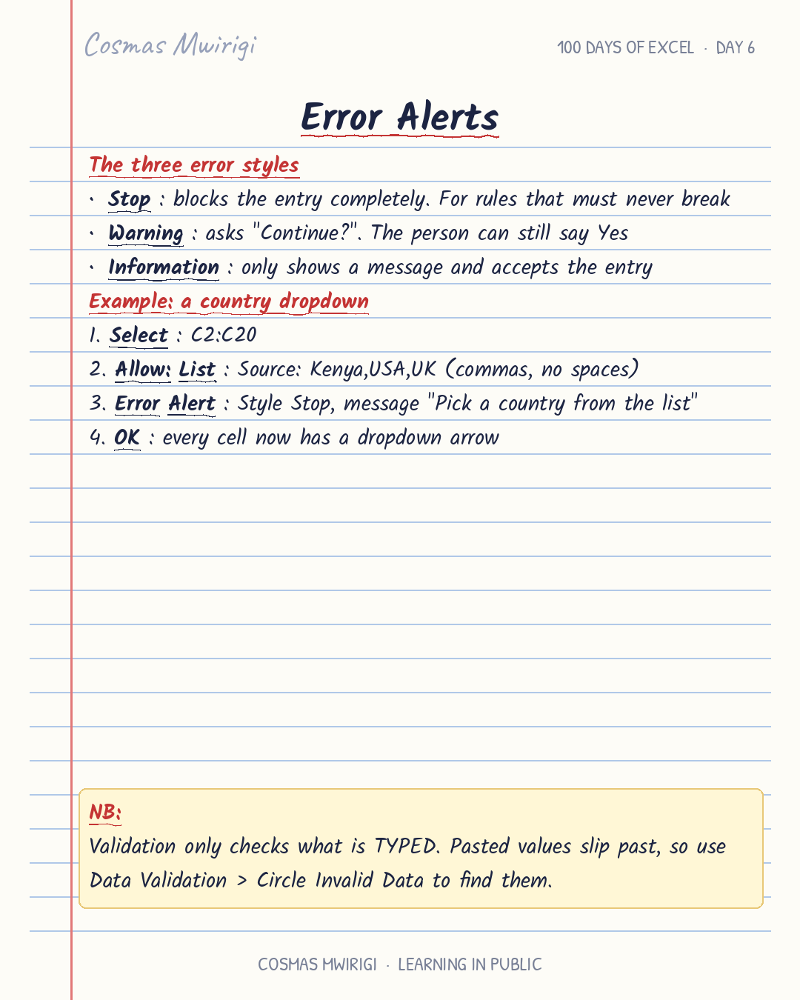
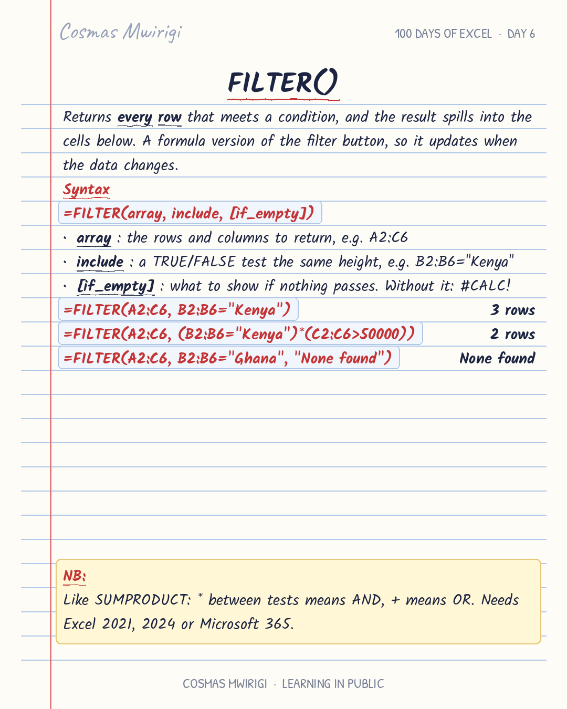
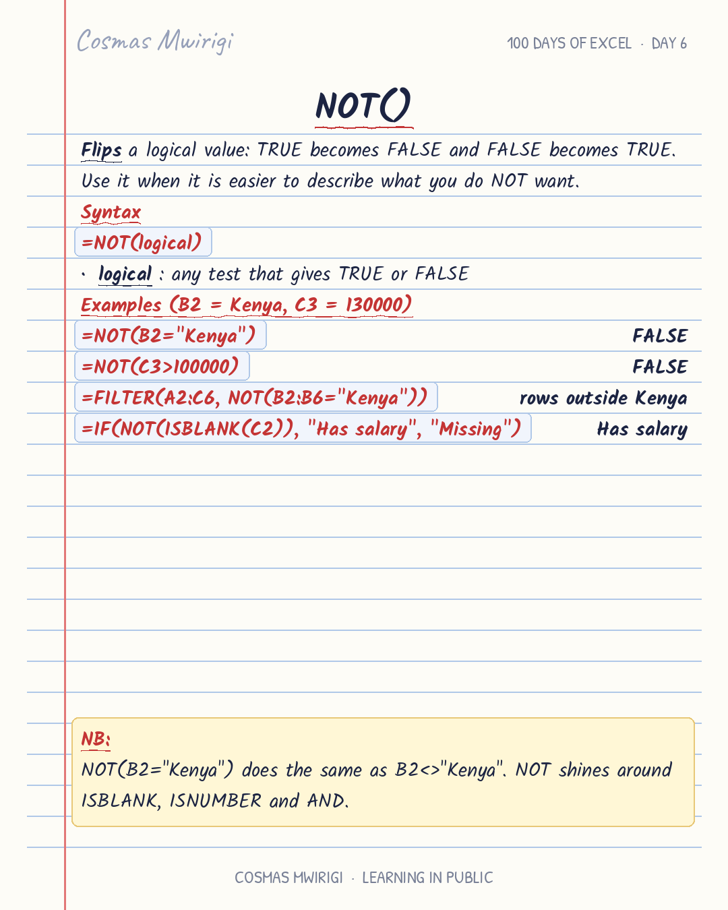
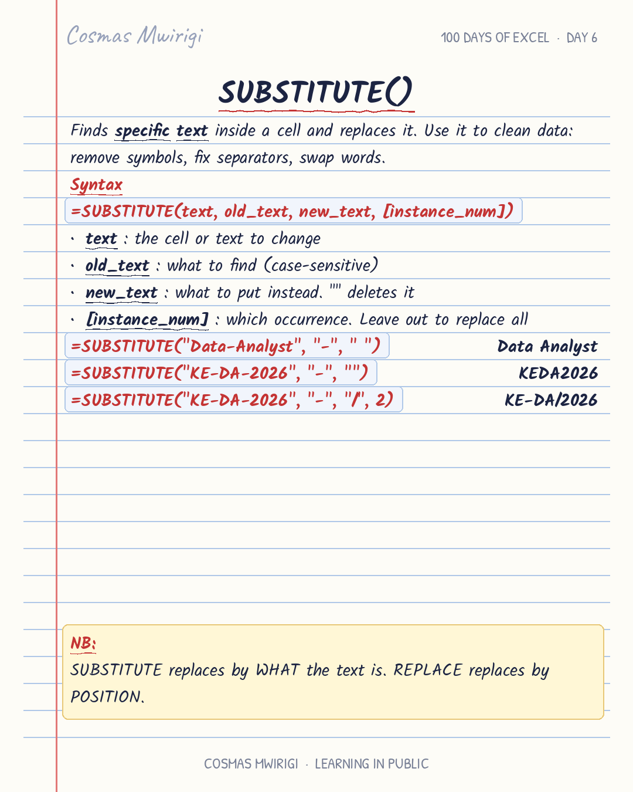
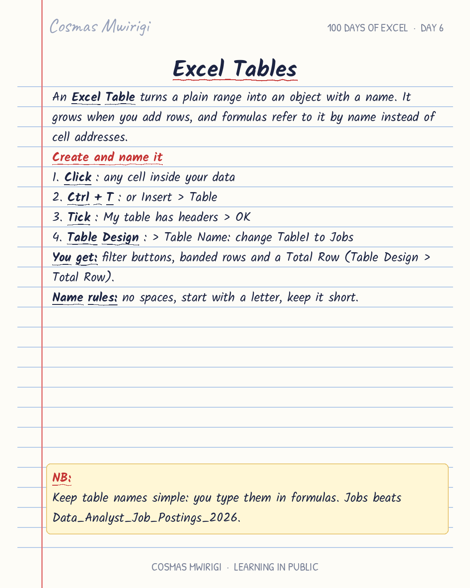
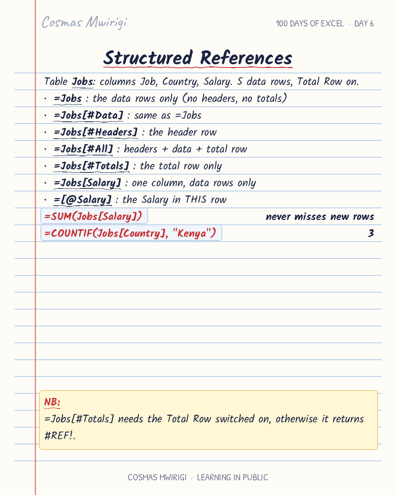
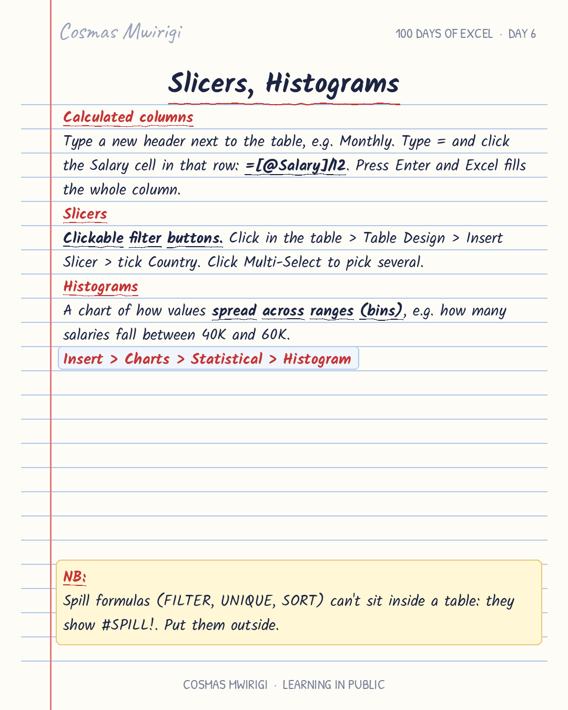

# Day 6: Protection, Data Validation, FILTER, NOT, SUBSTITUTE and Tables

Today was about keeping a shared workbook safe and clean: protecting sheets so people can't break formulas, data validation so bad values never get typed in, three functions for filtering and cleaning (FILTER, NOT, SUBSTITUTE), and Excel Tables with structured references.

Download [`day06_practice.xlsx`](./day06_practice.xlsx). It has one sheet per topic, yellow cells for your answers, Check cells that say Correct or Try again, and an Answers sheet.

## The practice data

| Job (A) | Country (B) | Salary (C) |
|---------|-------------|------------|
| Analyst | Kenya | 42000 |
| Scientist | USA | 130000 |
| Analyst | UK | 88000 |
| Engineer | Kenya | 55000 |
| Analyst | Kenya | 71000 |

The function examples below use this table in A1:C6.

---

## Protecting your work



Every cell in Excel is already marked **Locked**, but the lock does nothing until you protect the sheet. So you unlock the cells people may type in first, then protect the sheet.

**Why:** you share a sheet and want people to fill in inputs without breaking your formulas or headers.

1. Select the cells people may edit (for example B2:B10).
2. Press **Ctrl + 1** (Format Cells) and open the **Protection** tab.
3. Untick **Locked**, then click OK.
4. Go to **Review > Protect Sheet**.
5. Type a password (optional) and tick what users may still do: select unlocked cells, sort, use AutoFilter.
6. Click OK and type the password again.

To undo it: **Review > Unprotect Sheet**. Tick **Hidden** on the same Protection tab to hide a formula from the formula bar once the sheet is protected.



| What you protect | Where | What it stops |
|---|---|---|
| A sheet | Review > Protect Sheet | Editing locked cells |
| The workbook structure | Review > Protect Workbook | Adding, deleting, renaming, moving or hiding sheets |
| The whole file | File > Info > Protect Workbook > Encrypt with Password | Opening the file without the password |

> Write your passwords down. Excel cannot recover a forgotten one. Hiding rows, columns or sheets is not protection: anyone can unhide them.

## Data validation



Data validation is a rule on a cell that controls what can be typed into it. It keeps data clean before it reaches your formulas.

**Why:** to stop typos ("Kenia", "kenya "), give people a dropdown instead of free typing, and block impossible values like a negative salary.

**Where:** Data > Data Tools > Data Validation. The box has three tabs: **Settings** (the rule), **Input Message** (a tip when the cell is clicked) and **Error Alert** (what happens when the rule is broken).

| Allow | Use it for | Example rule |
|---|---|---|
| List | A dropdown of fixed choices | `Kenya,USA,UK` or `=$H$2:$H$4` |
| Whole number | Counts, ages, years | between 1 and 500000 |
| Decimal | Prices, rates | greater than 0 |
| Date | Deadlines, posting dates | between 01/01/2026 and 31/12/2026 |
| Text length | Codes and IDs of fixed length | equal to 10 |
| Custom | Any rule a formula can test | `=COUNTIF($A$2:$A$100,A2)=1` (no duplicates) |



| Error style | What it does |
|---|---|
| Stop | Blocks the entry completely. Use it for rules that must never break |
| Warning | Asks "Continue?". The person can still say Yes |
| Information | Only shows a message and accepts the entry |

> Validation only checks what is typed. Pasted values can slip past it, so use **Data > Data Validation > Circle Invalid Data** to find bad values already in the sheet.

## FILTER



FILTER returns every row that meets a condition, and the result spills into the cells below. It is a formula version of the filter button, so it updates when the data changes.

```
=FILTER(array, include, [if_empty])
```

| Formula | Returns |
|---|---|
| `=FILTER(A2:C6, B2:B6="Kenya")` | The 3 Kenya rows |
| `=FILTER(A2:C6, (B2:B6="Kenya")*(C2:C6>50000))` | Kenya AND above 50,000: Engineer 55000, Analyst 71000 |
| `=FILTER(A2:C6, (B2:B6="UK")+(B2:B6="USA"))` | UK OR USA: 2 rows |
| `=FILTER(A2:C6, B2:B6="Ghana", "None found")` | None found |

`*` between tests means AND, `+` means OR. Without `if_empty`, no match gives `#CALC!`. FILTER needs Excel 2021, 2024 or Microsoft 365.

## NOT



NOT flips a logical value: TRUE becomes FALSE and FALSE becomes TRUE. Use it when it is easier to describe what you do not want.

```
=NOT(logical)
```

| Formula | Result |
|---|---|
| `=NOT(B2="Kenya")` | FALSE, because B2 is Kenya |
| `=NOT(C3>100000)` | FALSE, because 130000 is above 100000 |
| `=FILTER(A2:C6, NOT(B2:B6="Kenya"))` | Every row outside Kenya |
| `=IF(NOT(ISBLANK(C2)), "Has salary", "Missing")` | Has salary |

## SUBSTITUTE



SUBSTITUTE finds specific text inside a cell and replaces it. Use it to clean data: remove symbols, fix separators, swap words.

```
=SUBSTITUTE(text, old_text, new_text, [instance_num])
```

| Formula | Result |
|---|---|
| `=SUBSTITUTE("Data-Analyst", "-", " ")` | Data Analyst |
| `=SUBSTITUTE("KE-DA-2026", "-", "")` | KEDA2026 |
| `=SUBSTITUTE("KE-DA-2026", "-", "/", 2)` | KE-DA/2026 (only the 2nd dash) |
| `=VALUE(SUBSTITUTE(SUBSTITUTE("$42,000", "$", ""), ",", ""))` | 42000 as a real number |

`old_text` is case-sensitive. SUBSTITUTE replaces by what the text is. REPLACE replaces by position.

## Tables and structured references



An Excel Table turns a plain range into an object with a name. It grows when you add rows, and formulas can refer to it by name instead of cell addresses.

1. Click any cell inside your data.
2. Press **Ctrl + T** (or Insert > Table) and tick **My table has headers**.
3. Click inside the table, open **Table Design**, and change **Table Name** from Table1 to `Jobs`.

Keep table names simple (no spaces, start with a letter), because you type them in formulas.



| Reference | What it points to |
|---|---|
| `=Jobs` | The data rows only (no headers, no totals) |
| `=Jobs[#Data]` | Same as `=Jobs` |
| `=Jobs[#Headers]` | The header row |
| `=Jobs[#All]` | Headers + data + total row |
| `=Jobs[#Totals]` | The total row only (needs Table Design > Total Row on) |
| `=Jobs[Salary]` | One column, data rows only |
| `=[@Salary]` | The Salary in this row |

Use them inside functions: `=SUM(Jobs[Salary])`, `=COUNTIF(Jobs[Country], "Kenya")`. They never miss rows you add later.



- **Calculated column:** type a new header next to the table, then `=[@Salary]/12` in its first row. Excel fills the whole column, and new rows get it automatically.
- **Slicers:** clickable filter buttons. Click in the table > Table Design > Insert Slicer. Multi-Select picks several.
- **Histograms:** a chart of how values spread across ranges (bins), such as how many salaries fall between 40K and 60K. Insert > Charts > Statistical > Histogram.

> Spill formulas (FILTER, UNIQUE, SORT) can't sit inside a table: they show `#SPILL!`. Put them in a cell outside the table.

## Files

| File | What's in it |
|---|---|
| [`day06_practice.xlsx`](./day06_practice.xlsx) | Practice sheets for protection, validation, FILTER/NOT/SUBSTITUTE, custom number formats, Tables and conditional formatting, plus an Answers sheet |

## Key takeaways

- Unlock the input cells, then protect the sheet. Locked means nothing until you protect.
- Data validation stops bad data at the door. Circle Invalid Data catches what was pasted in.
- FILTER is the formula version of the filter button: `*` is AND, `+` is OR.
- NOT flips TRUE and FALSE. SUBSTITUTE swaps text by what it is.
- Tables grow with your data, and structured references like `Jobs[Salary]` never miss a row.

---

[Back to all days](../README.md)
