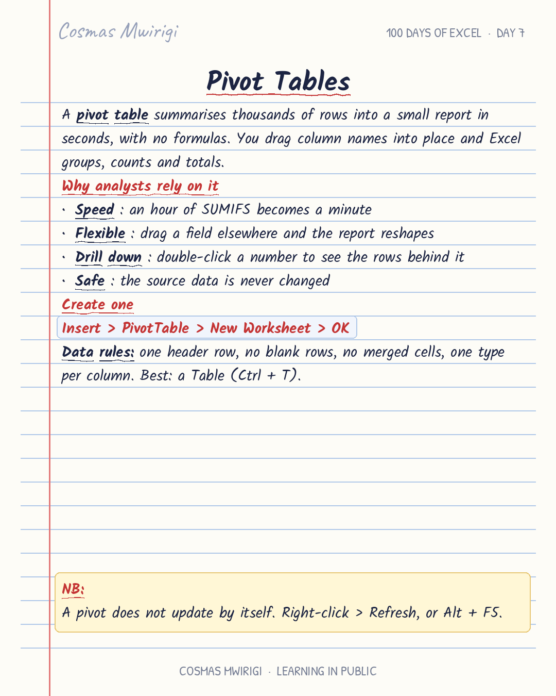
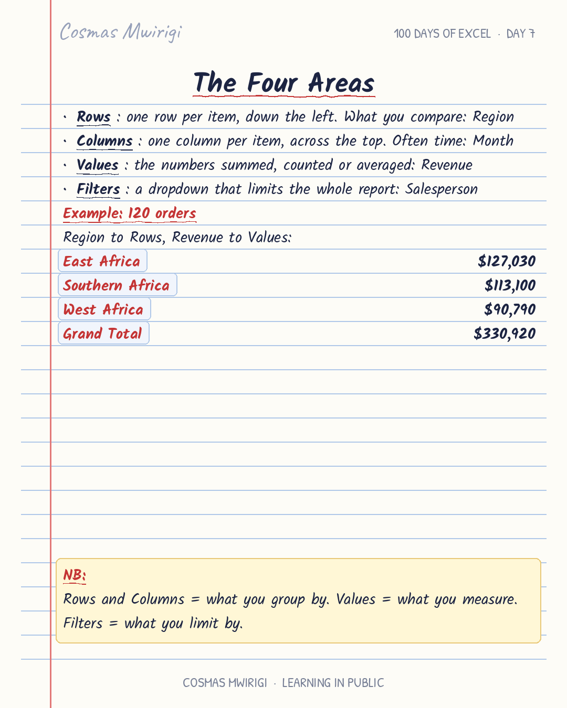
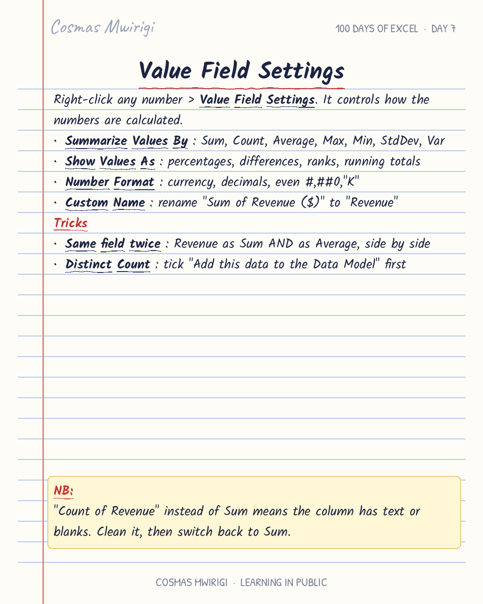
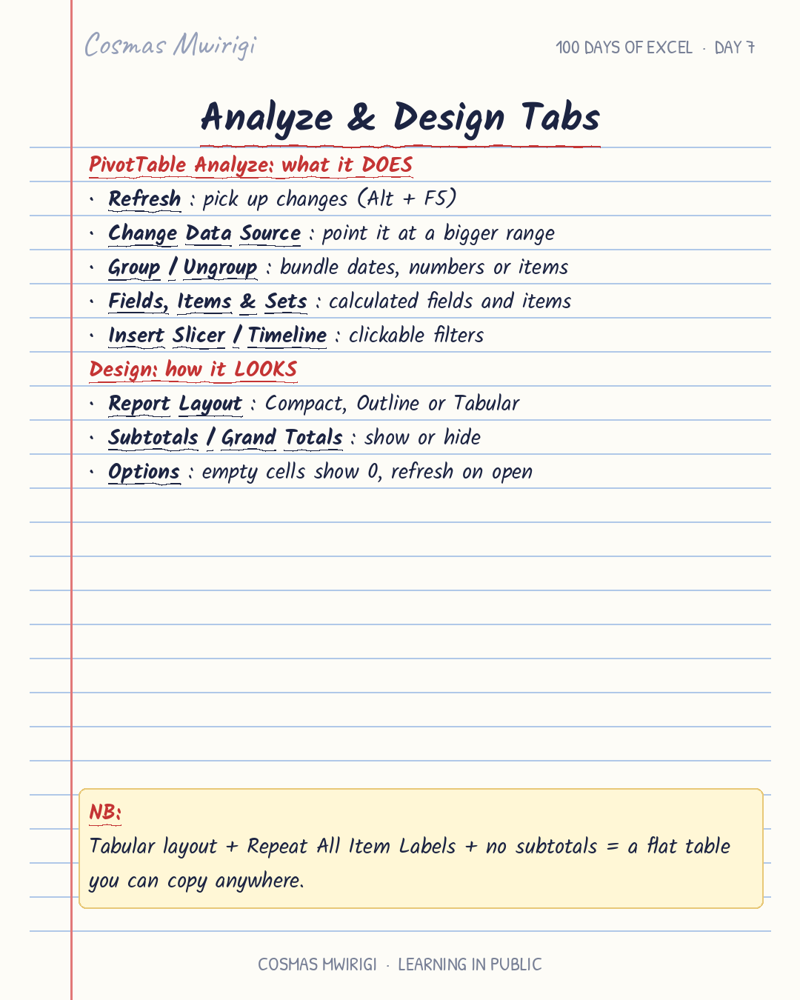
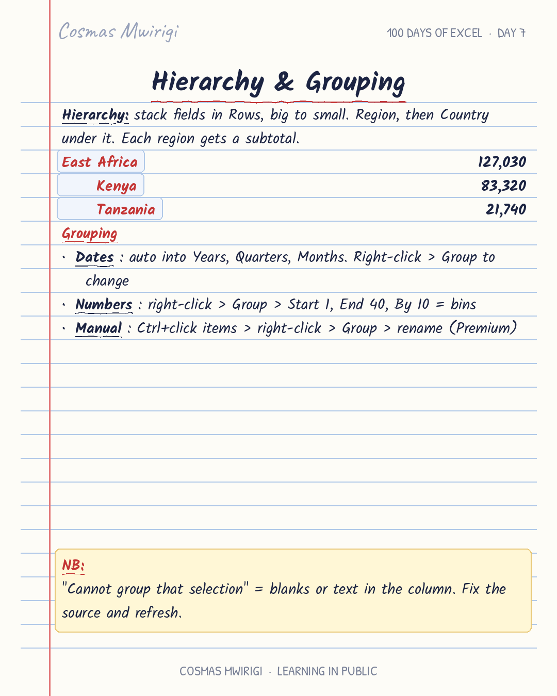
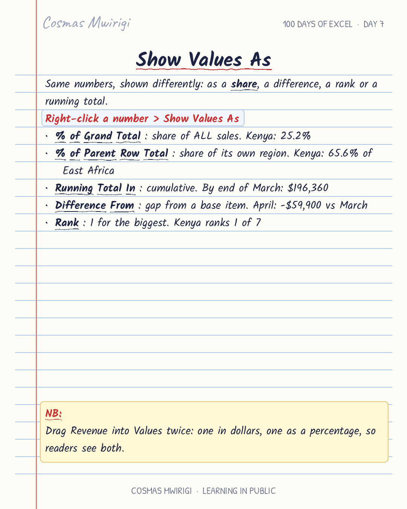
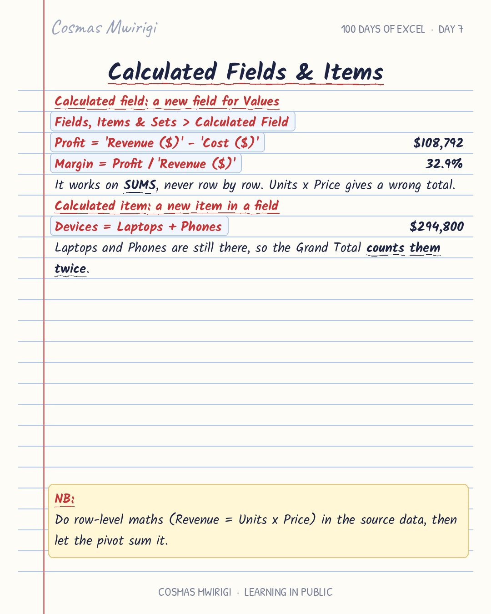
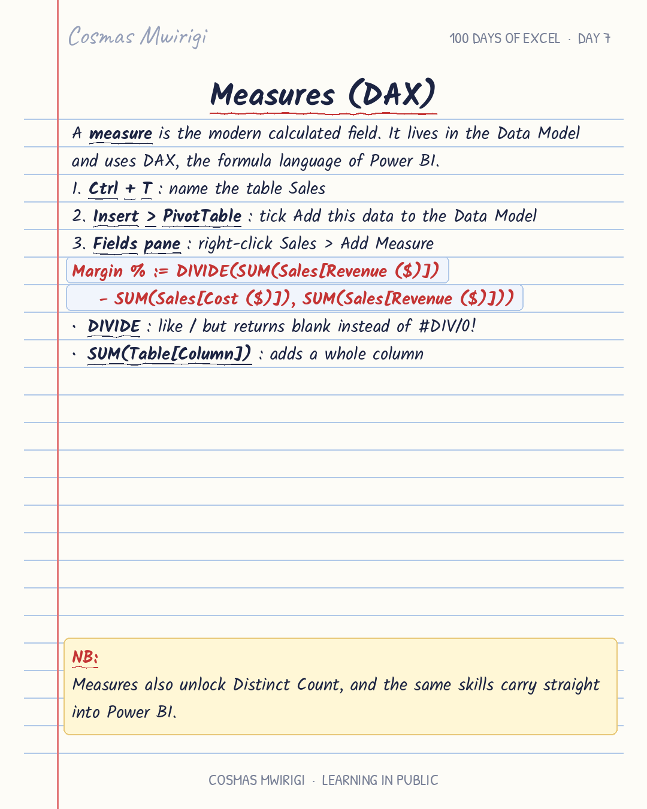
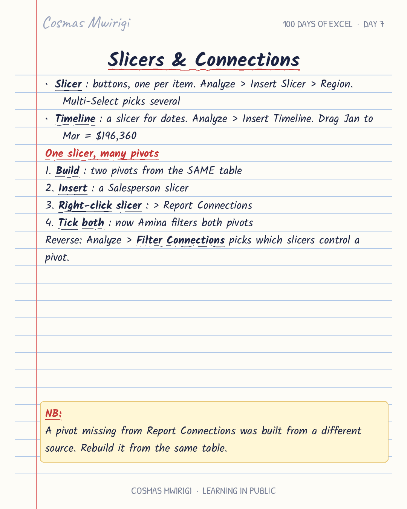

# Day 7: Pivot Tables in Detail

Today was the start of advanced Excel: pivot tables. A pivot table summarises thousands of rows into a small report in seconds, with no formulas. I learnt the four areas, Value Field Settings, the Analyze and Design tabs, hierarchies and grouping, Show Values As, calculated fields and items, measures, slicers, timelines and filter connections.

Download [`day07_pivot_practice.xlsx`](./day07_pivot_practice.xlsx). It has 120 made-up electronics orders as a table named `Sales`, 20 pivot tasks with yellow answer cells, Check cells that say Correct or Try again, and an Answers sheet with the steps.

## The practice data

| Order ID | Date | Region | Country | Category | Product | Salesperson | Units | Unit Price ($) | Unit Cost ($) | Revenue ($) | Cost ($) |
|---|---|---|---|---|---|---|---|---|---|---|---|
| 1001 | 01/01/2026 | ... | ... | ... | ... | ... | ... | ... | ... | Units x Price | Units x Cost |

120 orders from January to June 2026, across three regions and seven countries. Total revenue: **$330,920**.

---

## What a pivot table is



You drag column names into place and Excel groups, counts and totals the data. A summary that takes an hour of SUMIFS takes a minute, you can reshape it by dragging a field somewhere else, and double-clicking any number shows the rows behind it.

**Before you start:** one header row, no blank rows or columns, no merged cells, one data type per column. Best of all, format the data as a Table (Ctrl + T) so new rows are picked up on refresh.

**Create one:** click inside the data > Insert > PivotTable > New Worksheet > OK.

> A pivot table does not update by itself. Right-click > Refresh, or press Alt + F5.

## The four areas



| Area | What it does | Example |
|---|---|---|
| Rows | One row per unique item, down the left | Region |
| Columns | One column per unique item, across the top | Month |
| Values | The numbers that are summed, counted or averaged | Revenue |
| Filters | A dropdown that limits the whole report | Salesperson |

Region in Rows and Revenue in Values gives East Africa $127,030, Southern Africa $113,100 and West Africa $90,790.

## Value Field Settings



Right-click any number > **Value Field Settings** to change Sum to Count, Average, Max or Min, set the number format, rename the field, or open Show Values As. Drag the same field into Values twice to see total and average side by side. For a **Distinct Count**, tick *Add this data to the Data Model* when you create the pivot.

## The PivotTable Analyze and Design tabs



| Tab | Controls | Most used |
|---|---|---|
| PivotTable Analyze | What the pivot does | Refresh, Change Data Source, Group, Calculated Field, Insert Slicer and Timeline |
| Design | How it looks | Report Layout (Compact, Outline, Tabular), Subtotals, Grand Totals, Styles |
| PivotTable Options | Extra settings | Show 0 for empty cells, keep column widths, refresh on open |

## Hierarchy and grouping



Stack Region then Country in Rows to make a hierarchy with a subtotal per region.

| Row Labels | Revenue ($) |
|---|---|
| East Africa | 127,030 |
| &nbsp;&nbsp;Kenya | 83,320 |
| &nbsp;&nbsp;Tanzania | 21,740 |
| &nbsp;&nbsp;Uganda | 21,970 |

- **Dates** group automatically into Years, Quarters and Months: Qtr1 $196,360, Qtr2 $134,560.
- **Numbers** group into bins: right-click > Group > Start 1, End 40, By 10.
- **Manual grouping:** Ctrl+click Laptop Pro and Phone X > right-click > Group > rename the group Premium.

## Show Values As



| Option | Answers | Example |
|---|---|---|
| % of Grand Total | Share of all sales | Kenya: 25.2% |
| % of Parent Row Total | Share of its own region | Kenya: 65.6% of East Africa |
| Running Total In | Cumulative total | End of March: $196,360 |
| Difference From (previous) | Change from the month before | April: -$59,900 |
| Rank Largest to Smallest | Position | Kenya: 1 of 7 |

## Calculated fields, calculated items and measures



| | Adds | Example | Result |
|---|---|---|---|
| Calculated field | A new field for Values | Profit = 'Revenue ($)' - 'Cost ($)' | $108,792 |
| Calculated field | | Margin = Profit / 'Revenue ($)' | 32.9% |
| Calculated item | A new item inside a field | Devices = Laptops + Phones | $294,800 |

> A calculated field works on **sums**, never row by row. Do row-level maths in the source data. A calculated item leaves the original items in place, so the Grand Total counts them twice.



A **measure** lives in the Data Model and uses DAX, the language of Power BI:

```
Margin % := DIVIDE(SUM(Sales[Revenue ($)]) - SUM(Sales[Cost ($)]), SUM(Sales[Revenue ($)]))
```

## Slicers, timelines and filter connections



- **Slicer:** clickable buttons. PivotTable Analyze > Insert Slicer.
- **Timeline:** a slicer for dates. PivotTable Analyze > Insert Timeline.
- **Report Connections:** right-click a slicer > Report Connections > tick every pivot it should control. The pivots must come from the same source.

## Files

| File | What's in it |
|---|---|
| [`day07_pivot_practice.xlsx`](./day07_pivot_practice.xlsx) | 120 orders, 20 pivot tasks that check your answers, and the steps for each |

## Key takeaways

- Rows and Columns are what you group by, Values is what you measure, Filters is what you limit by.
- Refresh after the data changes, and use a Table as the source.
- Show Values As turns the same numbers into shares, differences and running totals.
- Calculated fields work on sums. Measures (DAX) are the stronger, Power BI-ready version.
- One slicer can drive several pivots through Report Connections: the start of a dashboard.

---

[Back to all days](../README.md)
