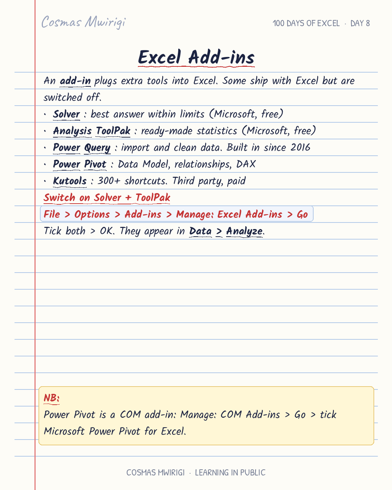
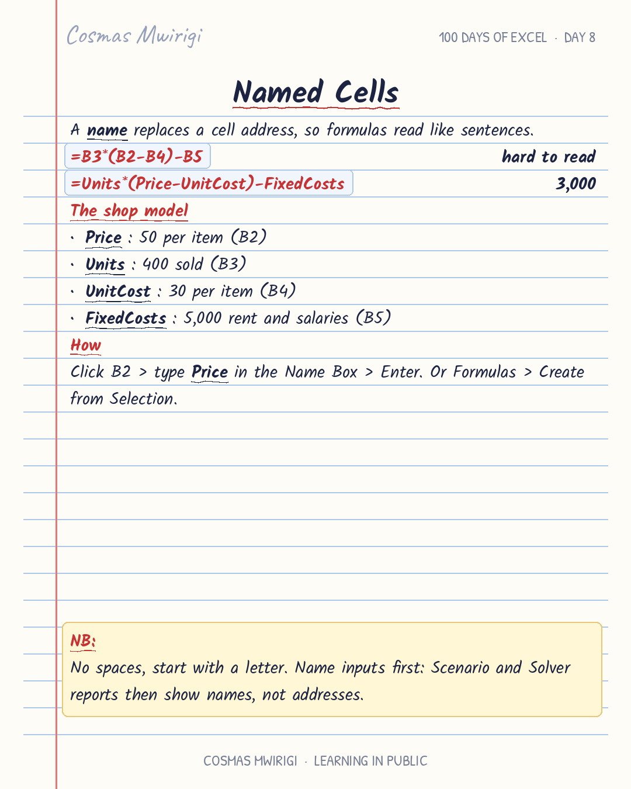
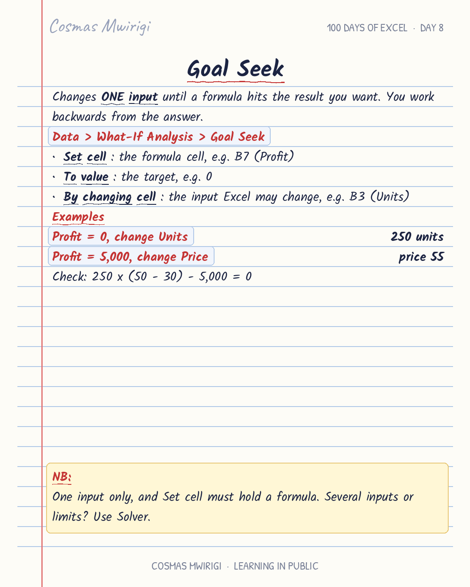
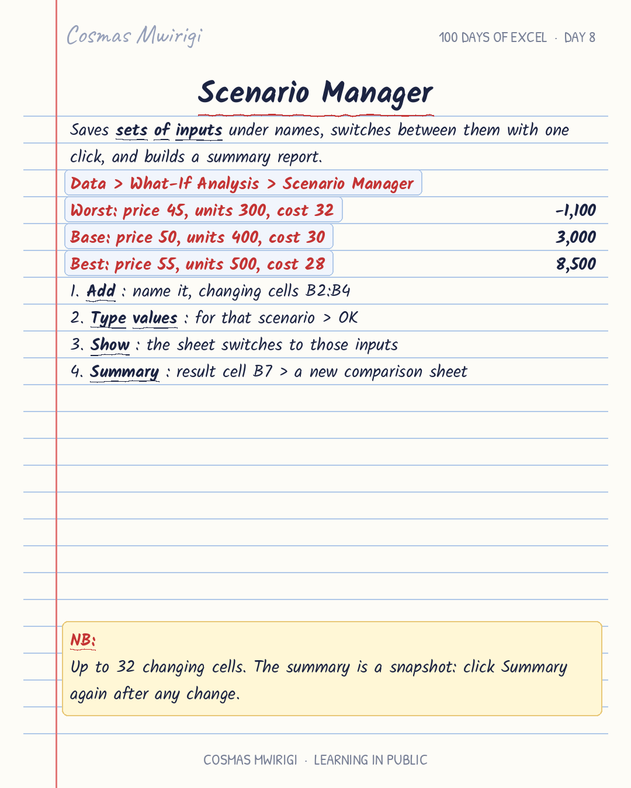
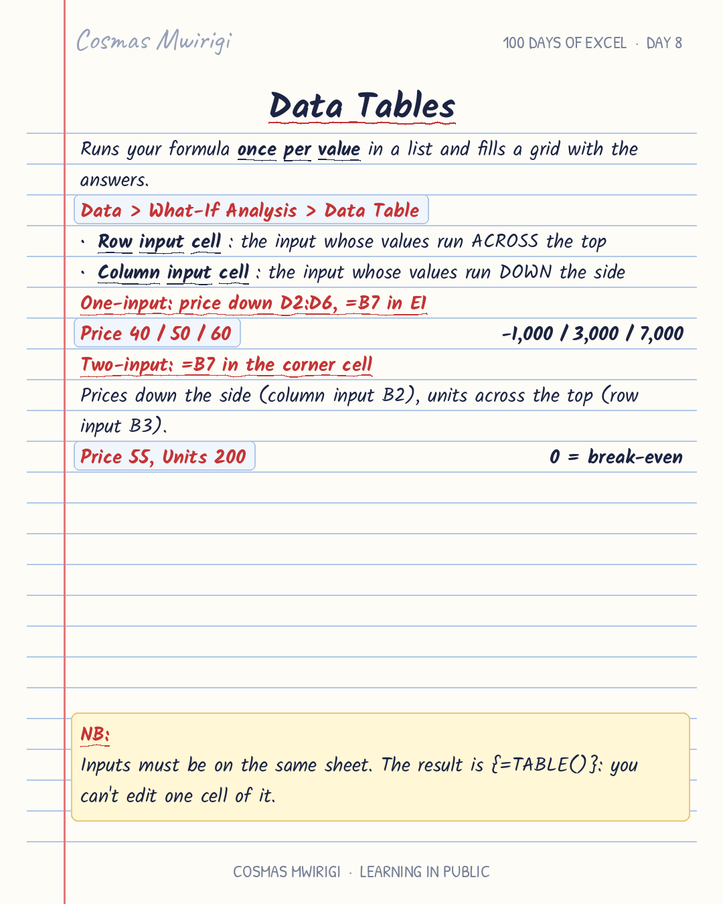
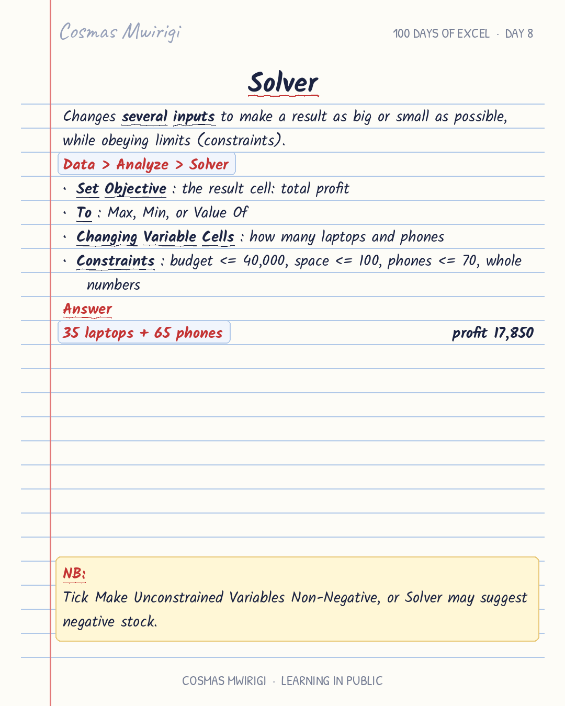
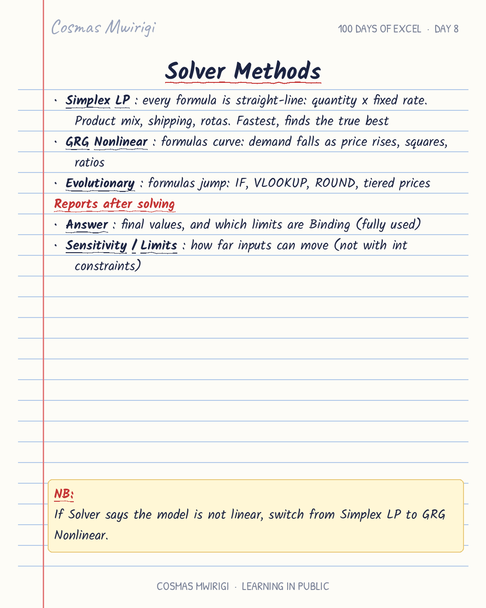
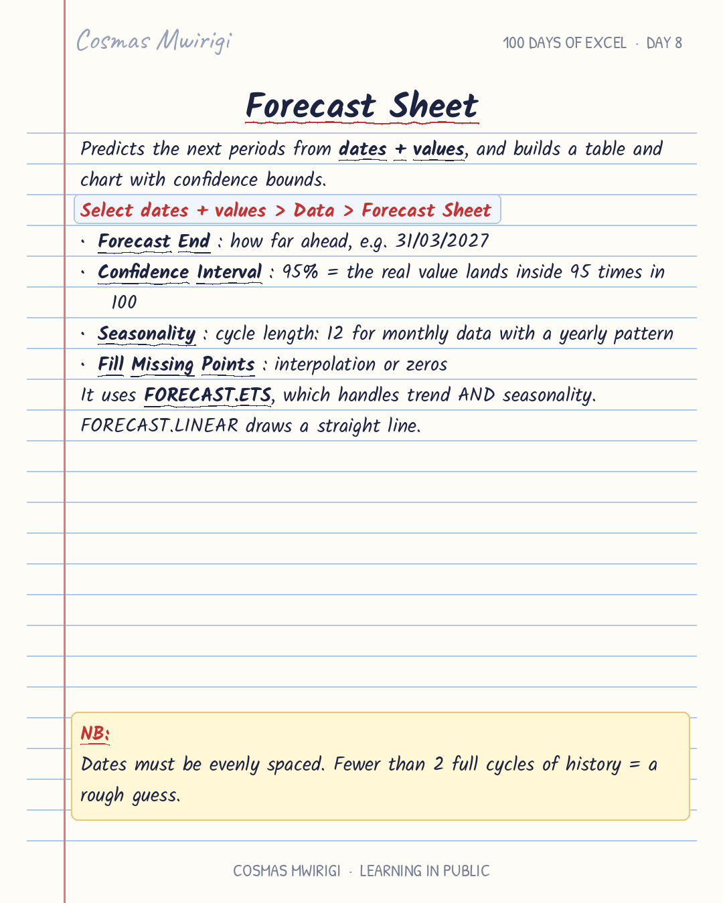
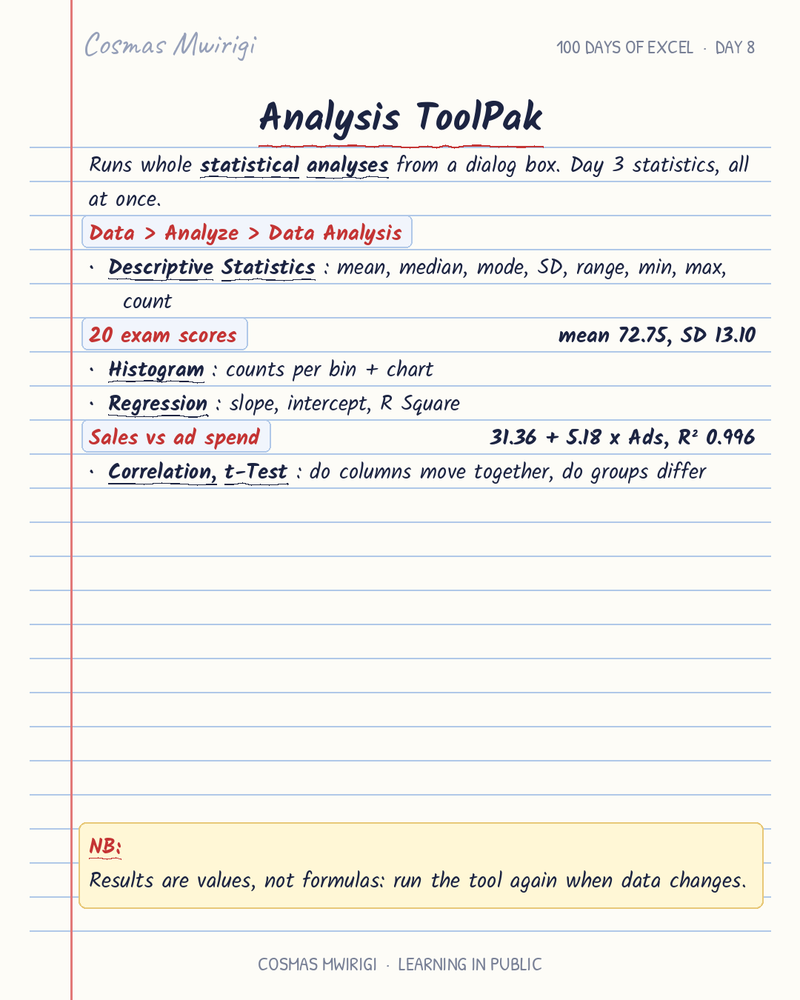
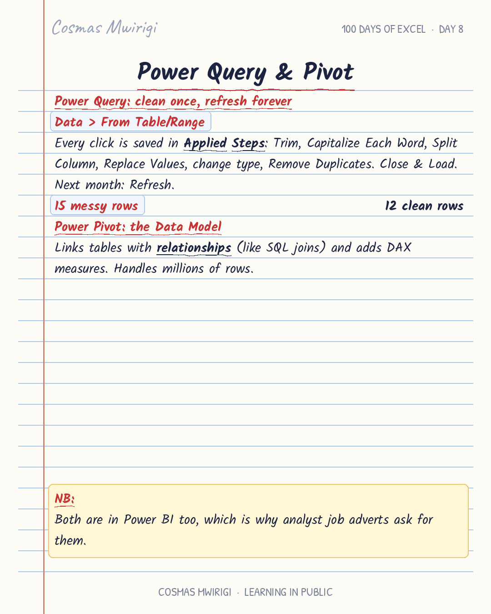

# Day 8: Add-ins and What-If Analysis

Today I learnt the Excel add-ins analysts use (Solver, Analysis ToolPak, Power Query, Power Pivot, Kutools) and the What-If Analysis tools that answer "what happens if?" and "what do I need to get there?": named cells, Goal Seek, Scenario Manager, Data Tables, Solver and Forecast Sheet.

Download [`day08_whatif_practice.xlsx`](./day08_whatif_practice.xlsx). It has one sheet per tool, yellow cells for your answers, Check cells that say Correct or Try again, and an Answers sheet. Switch on Solver and the Analysis ToolPak first.

## The model used in the examples

A phone accessories shop, one month:

| Cell | Name | Value |
|---|---|---|
| B2 | Price | 50 per item |
| B3 | Units | 400 sold |
| B4 | UnitCost | 30 per item |
| B5 | FixedCosts | 5,000 |
| B7 | Profit | `=Units*(Price-UnitCost)-FixedCosts` = **3,000** |

---

## Excel add-ins

| Add-in | What it does | Who makes it | Where |
|---|---|---|---|
| Solver | Best answer within limits | Microsoft, free, off by default | Data > Analyze |
| Analysis ToolPak | Ready-made statistics | Microsoft, free, off by default | Data > Analyze > Data Analysis |
| Power Query | Import and clean data with refreshable steps | Microsoft, built in since 2016 | Data > Get & Transform Data |
| Power Pivot | Data Model, relationships, DAX | Microsoft, COM add-in | Power Pivot tab |
| Kutools | 300+ shortcut tools | ExtendOffice, paid | Kutools tabs |

**Switch on Solver and the ToolPak:** File > Options > Add-ins > Manage: Excel Add-ins > Go > tick both > OK.

## Named cells

A name replaces a cell address: `=Units*(Price-UnitCost)-FixedCosts` instead of `=B3*(B2-B4)-B5`. Click a cell, type the name in the Name Box, press Enter, or use **Formulas > Create from Selection**. Manage them with Ctrl + F3.

## Goal Seek

Goal Seek changes **one input** until a formula reaches the value you want. **Data > What-If Analysis > Goal Seek**.

| Question | Set cell | To value | By changing | Answer |
|---|---|---|---|---|
| Break-even units? | B7 | 0 | B3 | 250 units |
| Price for 5,000 profit? | B7 | 5000 | B2 | 55 |

## Scenario Manager

Saves named sets of inputs and builds a summary report. **Data > What-If Analysis > Scenario Manager**.

| Scenario | Price | Units | UnitCost | Profit |
|---|---|---|---|---|
| Worst | 45 | 300 | 32 | -1,100 |
| Base | 50 | 400 | 30 | 3,000 |
| Best | 55 | 500 | 28 | 8,500 |

## Data Tables

A Data Table runs the formula once for every value in a list. **Data > What-If Analysis > Data Table**. Row input cell = the values across the top; Column input cell = the values down the side.

| Price \ Units | 200 | 300 | 400 | 500 |
|---|---|---|---|---|
| 40 | -3,000 | -2,000 | -1,000 | 0 |
| 50 | -1,000 | 1,000 | 3,000 | 5,000 |
| 60 | 1,000 | 4,000 | 7,000 | 10,000 |

## Solver

Solver changes several inputs to maximise or minimise a result within constraints. Laptops earn 250 and cost 650, phones earn 140 and cost 260. Budget 40,000, space for 100 items, phones at most 70.

**Answer:** 35 laptops and 65 phones, profit **17,850**.

| Method | Use it when |
|---|---|
| Simplex LP | Every formula is linear (quantity x fixed rate) |
| GRG Nonlinear | Formulas curve (prices that change with volume) |
| Evolutionary | Formulas jump (IF, VLOOKUP, ROUND) |

## Forecast Sheet

Select dates and values > **Data > Forecast Sheet**. Set the end date, confidence interval (95%) and seasonality (12 for monthly data). Excel builds a table and chart using `FORECAST.ETS`, which handles trend and seasonality.

## Analysis ToolPak

**Data > Analyze > Data Analysis**.

| Tool | Practice result |
|---|---|
| Descriptive Statistics (20 exam scores) | Mean 72.75, median 73, mode 70, SD 13.10, range 51 |
| Histogram (bins 50 to 100) | 1, 2, 6, 5, 4, 2 |
| Regression (sales vs ad spend) | Sales = 31.36 + 5.18 x Ads, R Square 0.996 |

## Power Query and Power Pivot

- **Power Query:** Data > From Table/Range. Trim, Capitalize Each Word, Split Column, Replace Values, change type, Remove Duplicates, then Close & Load. Every step is recorded, so next month you just click Refresh. In practice: 15 messy rows become 12 clean rows.
- **Power Pivot:** loads several tables into the Data Model, links them with relationships and adds DAX measures.

## Files

| File | What's in it |
|---|---|
| [`day08_whatif_practice.xlsx`](./day08_whatif_practice.xlsx) | Model, Data Tables, Solver, Forecast, ToolPak and Power Query sheets with checked answers |

## Key takeaways

- Name your input cells before you model.
- Goal Seek: one input, one target. Solver: many inputs, limits, the best answer.
- Scenario Manager compares whole cases; Data Tables show every value at once.
- Switch on Solver and the Analysis ToolPak from File > Options > Add-ins.
- Power Query and Power Pivot are the same tools as in Power BI.

Watch short Excel lessons built from these notes on YouTube: [Taught By A Stranger](https://www.youtube.com/@TaughtByAStranger).

---

[Back to all days](../README.md)
